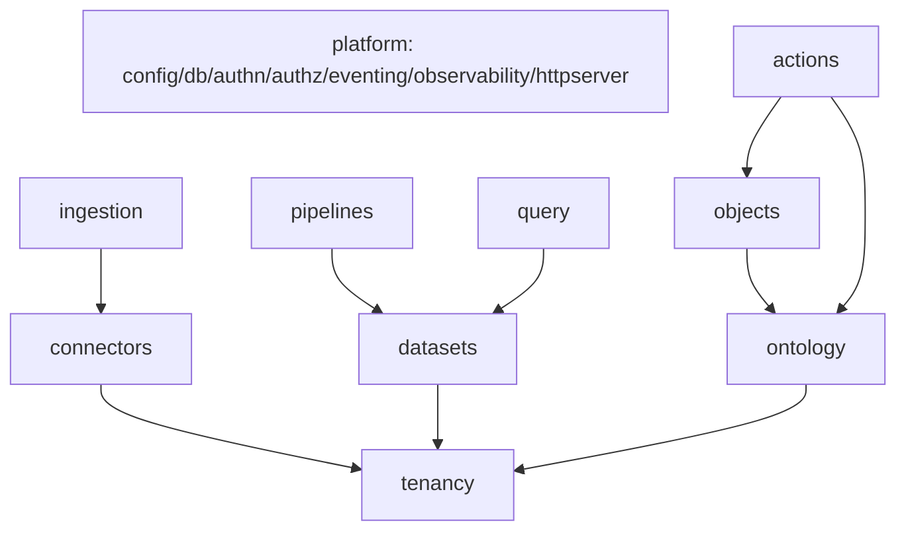

# OntoAxis 架构设计

> **项目名：OntoAxis（中文名：元轴）**
>
> **状态**：正式版 v1.3，2026-11-22<br>
> **设计基线**：采用五平面模型、清晰的业务领域边界与 `/api/v1` 路径；以 `proto/` 作为唯一契约源，只保留核心契约，从零定义 v1 接口；第三方组件默认使用绿名单许可证（MIT/Apache-2.0/BSD/ISC/PostgreSQL 等，详见 11.3）。<br>
> **结论**：采用 **1 个 Go 模块化核心 + 1 个 Envoy Gateway/Traefik 边缘 + 1 个 React 前端 + 成熟 OSS 数据面**。<br>
> **变更记录**：v1.3（2026-11-22）：将第 15 章从“设计缺口表”更新为“Stage 1 已关闭项 + 后续设计待办”。v1.2：移除第 13 章“从零构建顺序”与第 14 章“预期收益”；原 15–17 章顺延为 13–15。v1.1：移除原“实施计划”。<br>
> **定位**：本文件只保留目标设计、边界与关键决策；实施与验收记录见 `docs/stages/`。

---

## 1. 总体判断

OntoAxis 采用以下最终形态：

> **1 个 Go 模块化单体 `ontoaxis-core` + 1 个 Envoy Gateway/Traefik 边缘 + 1 个 React 前端 + 一组成熟 OSS 数据面。**

系统采用五平面模型、清晰的领域边界、`/api/v1` 路径和 `proto/` 契约；业务实现收敛为一个核心进程内的 9 个模块。

---

## 2. 目标部署形态

```text
                         ┌──────────────────────────────┐
Browser ────────────────▶│ Envoy Gateway / Traefik   │
                         │ JWT / 限流 / 路由 / 租户头   │
                         └──────────────┬───────────────┘
                                        │
                ┌───────────────────────┼────────────────────────┐
                │                       │                        │
         Keycloak OIDC            OpenFGA + Cedar          ontoaxis-core
         (登录/MFA/SSO)           (授权/策略)              (Go modular monolith)
                │                       │                        │
                └───────────────────────┴────────────┬───────────┘
                                                     │
              ┌──────────────┬──────────────┬────────┴─────────┐
              │              │              │                  │
        PostgreSQL       Meilisearch    Kestra/Temporal     Kafka
        (元数据/对象)     (对象搜索)      (Pipeline/Action)   (事件/CDC)
              │              │              │                  │
              └──────────────┴──────────────┴──────────────────┘
                                                     │
                                          Meltano / Kafka Connect
                                                     │
                                              Iceberg + Nessie
                                                     │
                                                   Trino
```

**自研部署单元只有 3 个：**

| 单元 | 技术 | 职责 |
|---|---|---|
| `oa-edge` | Envoy Gateway（K8s）/ Traefik（Compose） + YAML 配置 | API 网关、JWT、限流、路由、租户头 |
| `oa-core` | Go 单二进制 | 业务模块化单体 |
| `oa-web` | React + Refine + Caddy | 控制台前端 |

其余都是 OSS：Keycloak、OpenFGA、Cedar（库）、PostgreSQL、Kestra、Temporal、Trino、Iceberg、Nessie、Kafka、Meilisearch、SeaweedFS（默认）/ RustFS（候选）、Valkey。

---

## 3. `ontoaxis-core` 模块设计

### 3.1 设计原则

- 单 Go module、单进程；`cmd/ontoaxis-core` 只负责装配；
- 业务模块位于 `internal/modules/<domain>`，共享基础设施位于 `internal/platform`；
- 模块之间只能调用对方导出的 `Service` 接口，不允许跨模块直接读表；
- `platform` 不反向依赖具体模块；所有模块共享一个 `pgxpool`，但使用独立 schema；
- 每个模块自己拥有 `repo/migrations`，不设全局 migrations 目录。

### 3.2 仓库目录组织

OntoAxis 采用单二进制模块化单体；目录按职责分层，不设 `services/` 与 `libs/` 平行目录，也不保留按服务拆分的模板。

推荐目录：

```text
ontoaxis/
├── cmd/
│   └── ontoaxis-core/
│       └── main.go                 # 唯一进程入口，只做装配
├── internal/
│   ├── app/                       # 模块注册、启动顺序、生命周期、依赖装配
│   ├── platform/                  # 跨模块基础设施
│   │   ├── config/                # koanf + env
│   │   ├── db/                    # pgxpool、goose、transaction helper
│   │   ├── authn/                 # Keycloak JWT/JWKS 校验
│   │   ├── authz/                 # OpenFGA + Cedar 客户端
│   │   ├── eventing/              # outbox、Kafka、幂等消费
│   │   ├── observability/         # slog、OTel、Prometheus
│   │   ├── httpserver/            # Connect/HTTP 中间件、健康检查
│   │   ├── module/                # Module 接口与 registry
│   │   └── testutil/              # testcontainers、fixture helper
│   └── modules/
│       ├── tenancy/               # organization/workspace/membership/project
│       ├── connectors/            # connector catalog + Meltano/Kafka Connect
│       ├── ingestion/             # sync job / CDC 状态
│       ├── datasets/              # dataset metadata + Nessie/Iceberg
│       ├── pipelines/             # pipeline authoring + Kestra adapter
│       ├── query/                 # saved query + Trino/Flight SQL adapter
│       ├── ontology/              # object type/property/link + dataset binding
│       ├── objects/               # object/link instance + Meilisearch
│       └── actions/               # action type + Temporal
├── proto/
│   └── ontoaxis/v1/               # 仅存 .proto 源文件
├── gen/                           # buf generate 生成的 Go/Connect 代码，不手改
├── openapi/                       # 从 proto 生成的 OpenAPI
├── web/                           # React 19 + Refine + shadcn/ui
│   └── src/
│       ├── app/                   # router、Provider、AppShell
│       ├── features/              # 按业务域组织页面与 hooks
│       ├── components/            # 跨 feature 的 UI
│       ├── lib/                   # API client、auth、i18n
│       └── generated/             # orval 生成的 API hooks/types
├── deploy/
│   ├── compose/                   # 本地 14 容器栈
│   ├── helm/                      # Kubernetes charts
│   ├── argocd/                    # dev/staging/prod
│   └── observability/             # dashboards、alerts、OTel config
├── scripts/                       # 开发、生成、检查脚本
├── tests/
│   ├── integration/               # testcontainers
│   ├── e2e/                       # Playwright
│   └── fixtures/                  # golden JSON / seed data
├── benchmarks/                    # 性能基准
├── docs/                          # 面向使用者的中文文档
├── openspec/                      # Stage/change 治理
├── Makefile
├── go.mod
└── .github/workflows/
```

每个模块内部统一为：

```text
internal/modules/<domain>/
├── module.go                      # 实现 platform.Module
├── api/                           # Connect handler + DTO 映射
├── domain/                        # 纯业务类型与状态机
├── service/                       # 用例编排
├── repo/                          # sqlc 查询 + pgx 实现
│   └── migrations/                # goose SQL，模块自己拥有
└── events/                        # 该模块的 outbox/consumer（可选）
```

### 3.3 目录约束

- `cmd/` 只放 `main.go` 和启动装配，不能有业务逻辑；
- `internal/` 禁止外部模块 import；对外的 Go 包只放 `gen/`；
- 每个模块只能访问自己的 `repo/` 和 schema，跨模块调用必须走 `service` 接口；
- 不设全局 `utils/`/`common/` 大包；通用能力按职责放 `internal/platform/*`；
- 生成物（`gen/`、`web/src/generated/`、`openapi/`）由 `make generate` 重建，禁止手改；
- 迁移文件必须归属模块，禁止出现 shared `migrations/` 目录。

### 3.4 模块契约与依赖（P0 定稿）

#### 3.4.1 模块清单与公共接口

业务模块固定为 9 个；`identity`、`authorization`、`health`、`operation` 属于 platform 能力，不注册为业务模块。

| 模块 | 公共 Go 接口 | 主要操作 | 数据所有权 |
|---|---|---|---|
| `tenancy` | `tenancy.Service` | Organization、Workspace、Membership、Project、ProjectResource 的增删改查与绑定 | `core.*` |
| `connectors` | `connectors.Service` | Connector CRUD、Test、StartSync、InferSchema | `connector.connectors` |
| `ingestion` | `ingestion.Service` | IngestJob Create/Get/List/Cancel/Watch | `ingestion.sync_jobs`、`ingestion.sync_runs` |
| `datasets` | `datasets.Service` | Dataset CRUD、Preview、Version、Branch、Transaction、View | `dataset.*` |
| `pipelines` | `pipelines.Service`、`pipelines.ScheduleService` | Pipeline CRUD/Publish/TriggerRun；Schedule CRUD/Pause/Resume | `pipeline.*` |
| `query` | `query.Service` | Execute/Explain、SavedQuery CRUD | `query.saved_queries` |
| `ontology` | `ontology.Service` | ObjectType/Property/LinkType CRUD、Dataset Binding | `ontology.object_types`、`ontology.properties`、`ontology.link_types` |
| `objects` | `objects.Service` | Object/ObjectLink CRUD、BatchUpsert、按类型查询 | `object_data.objects`、`object_data.object_links` |
| `actions` | `actions.Service` | ActionType CRUD、Validate/Preview/Run、Execution 查询/取消/重试 | `action.action_types`、`action.action_executions` |

`Project` / `ProjectResource` 的唯一 owner 是 `tenancy`，表位于 `core` schema；`ontology` 只保存 object type/property/link 与 dataset binding，不读写 project 表。

#### 3.4.2 依赖方向

依赖箭头表示“调用方 → 被调用方”；禁止反向依赖、循环依赖和跨模块直接读表。



- `tenancy` 不依赖任何业务模块；
- `connectors`、`datasets`、`ontology` 只依赖 `tenancy`；
- `objects` 只依赖 `ontology`；`actions` 依赖 `ontology` 与 `objects`；
- `pipelines` 依赖 `datasets`；`query` 依赖 `datasets`；
- `platform` 不被任何业务模块反向依赖；业务模块通过构造函数注入 platform 接口。

#### 3.4.3 `api/` 与 `service/` 的边界

每个模块的 Go 包边界固定如下：

```text
internal/modules/<domain>/
├── module.go        # 实现 platform.Module，负责装配与路由注册
├── api/             # Connect handler / DTO 映射
├── domain/          # 纯领域类型、状态机、领域错误
├── service/         # 对外导出的 Service 接口 + 实现
├── repo/            # 仅本模块 schema 的 sqlc/pgx 查询
└── migrations/      # goose SQL，模块自己拥有
```

边界规则：

1. **`api/` 只做协议适配**：把生成的 `gen/ontoaxis/v1/<domain>` 请求映射为 `service` 输入，把 `service` 返回值映射回 proto 响应；不得写业务规则、SQL 或事务。
2. **`service/` 只暴露领域接口**：接口输入/输出使用 `domain` 类型，不 import `gen/` protobuf 类型；跨模块调用只能依赖对方 `service` 接口。
3. **`domain/` 不依赖数据库或 HTTP**：状态机、值对象、业务校验放这里；错误使用 `domain.Err*` 哨兵。
4. **`repo/` 不导出到模块外**：只由本模块 `service` 使用；SQL 必须带 `tenant_id`，表名限定到本模块 schema。
5. **`module.go` 只做装配**：`Name()`、`Dependencies()`、`RegisterRoutes()`、`Migrate()`、`Ready()` 五个方法；不得包含业务分支。
6. **跨模块事务**：不允许跨模块共享事务或直接 join；需要最终一致时通过 `jobs.outbox` 发事件，需要同步结果时调用对方 `service`。

#### 3.4.4 模块注册顺序

`internal/app` 按以下固定顺序构造模块；依赖未就绪时启动失败，不允许“半可用”启动：

1. `platform`（config → observability → db → authn → authz → eventing → httpserver）
2. `tenancy`
3. `connectors`
4. `ingestion`
5. `datasets`
6. `pipelines`
7. `ontology`
8. `objects`
9. `query`
10. `actions`

`Module` 接口：

```go
type Module interface {
    Name() string
    Dependencies() []string
    Migrate(ctx context.Context, pool *pgxpool.Pool) error
    RegisterRoutes(r chi.Router)
    Ready(ctx context.Context) error
}
```

#### 3.4.5 模块契约验收

- 每个模块有且只有一个导出的 `Service` 接口（`pipelines` 为 `Service` + `ScheduleService`），接口清单与本节及 9.5 一致；
- `api/` 的每个 RPC 都能在 `service` 找到唯一用例方法，禁止 handler 直接调用 `repo`；
- 依赖图中不存在反向边；`go list -deps` 或静态检查能证明业务模块未 import 其他模块的 `repo/`；
- 每个模块的 `migrations/` 能在空 schema 独立跑通，表名全部符合 3.4.1 的数据所有权；
- 任一模块的 `Ready()` 失败时整体启动失败，并输出缺失依赖。

---

## 4. 业务领域与模块映射

| 业务领域 | 实现位置 | 说明 |
|---|---|---|
| API 网关 | Envoy Gateway / Traefik | 无自研 Go 网关 |
| 身份认证 | Keycloak | 登录、MFA、OIDC/SAML、JWKS |
| 授权策略 | OpenFGA + Cedar | ReBAC + ABAC/Cedar 兼容 |
| 租户与组织 | `tenancy` module | 组织、workspace、membership、project、project resource |
| 连接器管理 | `connectors` module + Meltano | 连接器目录与同步 |
| 数据接入 | `ingestion` module + Kafka Connect/Debezium | CDC/同步状态 |
| 数据集 | `datasets` module + Iceberg/Nessie | 数据集、分支、提交 |
| Pipeline | `pipelines` module + Kestra | 作者 API / 执行适配 |
| SQL/BI | Trino | 外部 SQL 边缘 |
| 本体定义 | `ontology` module | 对象类型、属性、链接、dataset binding |
| 对象数据库 | `objects` module + PostgreSQL JSONB | 对象/链接实例 |
| 对象查询 | `query`/`objects` module + Meilisearch | 点查、搜索、过滤 |
| 动作编排 | `actions` module + Temporal | 动作执行、重试、补偿 |

---

## 5. 数据架构

### 5.1 PostgreSQL schema

```text
ontoaxis_core
  core.tenants
  core.organizations
  core.workspaces
  core.memberships
  core.projects
  core.project_resources

  connector.connectors

  ingestion.sync_jobs
  ingestion.sync_runs

  dataset.datasets
  dataset.dataset_branches
  dataset.dataset_transactions
  dataset.dataset_views
  dataset.dataset_permissions
  dataset.quality_rules
  dataset.retention_policies
  dataset.pipeline_bindings

  pipeline.pipelines
  pipeline.versions
  pipeline.runs
  pipeline.schedules

  query.saved_queries

  ontology.object_types
  ontology.properties
  ontology.link_types

  object_data.objects
  object_data.object_links

  action.action_types
  action.action_executions

  jobs.outbox
  jobs.operations
```

原则：

- 所有租户级业务表带 `tenant_id`（`core.tenants` 为全局租户表，除外）；
- Row-Level Security 做租户隔离；
- `sqlc` 生成类型安全查询，`goose` 管理迁移；
- 不引入 ORM；
- 不按服务拆独立数据库，避免跨库事务和连接池碎片化；
- 缓存、限流计数、幂等键统一使用 **Valkey（BSD-3-Clause）**，不依赖 Redis 专有模块。

#### 5.1.1 通用列与约束

所有租户级业务表统一包含：

```sql
id uuid PRIMARY KEY,
tenant_id uuid NOT NULL,
created_at timestamptz NOT NULL DEFAULT now(),
updated_at timestamptz NOT NULL DEFAULT now()
```

- `core.tenants` 是全局租户表，例外地没有 `tenant_id`；`jobs.outbox` 使用 `created_at`/`published_at`，不强制 `updated_at`；其余业务表按上述公共列补齐，5.1.2 仅列业务关键列。
- ID 由应用层生成 UUIDv7，不依赖数据库扩展；数据库只做唯一性约束。
- 除 `jobs.outbox` 外，所有业务表启用 `ROW LEVEL SECURITY` 并 `FORCE ROW LEVEL SECURITY`。
- 租户策略固定为：`tenant_id = current_setting('app.tenant_id', true)::uuid`；平台运维通过 `app.is_platform_admin = 'true'` 的独立 policy 放行。
- 每个租户级唯一键都必须包含 `tenant_id`（例如 `UNIQUE (tenant_id, name)`），禁止全局唯一业务名。
- 删除统一使用 `deleted_at timestamptz NULL` 软删除；`dataset`、`pipeline`、`connector` 的列表默认过滤 `deleted_at IS NULL`。

#### 5.1.2 核心表设计

| 表 | 关键列 | 约束/索引 |
|---|---|---|
| `core.tenants` | `id`, `name`, `slug`, `status`, `created_at`, `updated_at` | `UNIQUE(slug)`；`status IN ('active','suspended')` |
| `core.organizations` | `id`, `tenant_id`, `name`, `slug`, `parent_id`, `deleted_at` | `UNIQUE(tenant_id, slug)`；`INDEX(tenant_id, parent_id)` |
| `core.workspaces` | `id`, `tenant_id`, `organization_id`, `name`, `slug`, `deleted_at` | `UNIQUE(tenant_id, organization_id, slug)` |
| `core.memberships` | `id`, `tenant_id`, `principal_type`, `principal_id`, `organization_id`, `workspace_id`, `role`, `status`, `created_at` | `UNIQUE(tenant_id, principal_type, principal_id, organization_id, workspace_id)`；`principal_type IN ('user','group','service')`；`status IN ('active','invited','suspended')` |
| `core.projects` | `id`, `tenant_id`, `organization_id`, `workspace_id`, `name`, `display_name`, `description`, `created_by`, `deleted_at` | `UNIQUE(tenant_id, organization_id, name) WHERE deleted_at IS NULL`；`INDEX(tenant_id, workspace_id)` |
| `core.project_resources` | `id`, `tenant_id`, `project_id`, `resource_type`, `resource_id`, `created_at` | `UNIQUE(tenant_id, project_id, resource_type, resource_id)`；`resource_type IN ('object_type','dataset','pipeline','dashboard')` |
| `connector.connectors` | `id`, `tenant_id`, `name`, `display_name`, `connector_type`, `config jsonb`, `secret_ref`, `status`, `created_by`, `deleted_at` | `UNIQUE(tenant_id, name)`；`connector_type IN ('postgres','mysql','s3','rest_api','kafka')`；`status IN ('active','paused','error')`；`config` 只存非敏感配置 |
| `ingestion.sync_jobs` | `id`, `tenant_id`, `connector_id`, `mode`, `status`, `config jsonb`, `created_at`, `started_at`, `finished_at` | `INDEX(tenant_id, connector_id, created_at DESC)`；`status IN ('queued','running','succeeded','failed','cancelled')` |
| `ingestion.sync_runs` | `id`, `tenant_id`, `job_id`, `status`, `stats jsonb`, `error text`, `started_at`, `finished_at` | `INDEX(tenant_id, job_id, started_at DESC)` |
| `dataset.datasets` | `id`, `tenant_id`, `name`, `display_name`, `description`, `rid`, `format`, `storage_location`, `owner_id`, `tags jsonb`, `deleted_at` | `UNIQUE(tenant_id, name)`；`UNIQUE(rid)`；`format IN ('iceberg','parquet')` |
| `dataset.dataset_branches` | `id`, `tenant_id`, `dataset_id`, `name`, `parent_branch_id`, `head_transaction_id`, `created_from_transaction_id`, `fallback_chain jsonb`, `labels jsonb` | `UNIQUE(tenant_id, dataset_id, name)`；`INDEX(tenant_id, dataset_id)`；`parent_branch_id REFERENCES dataset.dataset_branches(id)` |
| `dataset.dataset_transactions` | `id`, `tenant_id`, `dataset_id`, `branch_id`, `transaction_type`, `status`, `message`, `started_at`, `committed_at`, `metadata jsonb` | `INDEX(tenant_id, dataset_id, branch_id, started_at DESC)`；`status IN ('open','committed','aborted')` |
| `dataset.dataset_views` | `id`, `tenant_id`, `dataset_id`, `branch_id`, `name`, `query text`, `version`, `created_at` | `UNIQUE(tenant_id, dataset_id, name)` |
| `dataset.dataset_permissions` | `id`, `tenant_id`, `dataset_id`, `principal_type`, `principal_id`, `permission` | `UNIQUE(tenant_id, dataset_id, principal_type, principal_id, permission)` |
| `dataset.quality_rules` | `id`, `tenant_id`, `dataset_id`, `name`, `rule_type`, `config jsonb`, `enabled` | `UNIQUE(tenant_id, dataset_id, name)` |
| `dataset.retention_policies` | `id`, `tenant_id`, `dataset_id`, `ttl_days`, `archive_after_days`, `updated_at` | `UNIQUE(tenant_id, dataset_id)` |
| `dataset.pipeline_bindings` | `id`, `tenant_id`, `dataset_id`, `pipeline_id`, `direction`, `created_at` | `UNIQUE(tenant_id, dataset_id, pipeline_id, direction)` |
| `pipeline.pipelines` | `id`, `tenant_id`, `name`, `display_name`, `description`, `pipeline_type`, `dag jsonb`, `version`, `status`, `created_by`, `deleted_at` | `UNIQUE(tenant_id, name)`；`pipeline_type IN ('batch','faster','incremental')`；`status IN ('draft','published','archived')` |
| `pipeline.versions` | `id`, `tenant_id`, `pipeline_id`, `version`, `dag jsonb`, `published_at`, `published_by` | `UNIQUE(tenant_id, pipeline_id, version)` |
| `pipeline.runs` | `id`, `tenant_id`, `pipeline_id`, `version`, `status`, `trigger_type`, `started_at`, `finished_at`, `error text` | `INDEX(tenant_id, pipeline_id, started_at DESC)`；`status IN ('queued','running','succeeded','failed','cancelled')` |
| `pipeline.schedules` | `id`, `tenant_id`, `pipeline_id`, `cron`, `timezone`, `enabled`, `next_run_at` | `UNIQUE(tenant_id, pipeline_id, cron)`；`INDEX(enabled, next_run_at)` |
| `query.saved_queries` | `id`, `tenant_id`, `name`, `sql text`, `owner_id`, `created_at`, `updated_at` | `UNIQUE(tenant_id, name)` |
| `ontology.object_types` | `id`, `tenant_id`, `name`, `display_name`, `primary_key_property`, `backing_dataset_id`, `status`, `deleted_at` | `UNIQUE(tenant_id, name)`；`status IN ('active','draft','deprecated')` |
| `ontology.properties` | `id`, `tenant_id`, `object_type_id`, `name`, `display_name`, `property_type`, `required`, `config jsonb` | `UNIQUE(tenant_id, object_type_id, name)` |
| `ontology.link_types` | `id`, `tenant_id`, `name`, `source_type_id`, `target_type_id`, `cardinality` | `UNIQUE(tenant_id, name)`；`cardinality IN ('one_to_one','one_to_many','many_to_many')` |
| `object_data.objects` | `id`, `tenant_id`, `object_type_id`, `properties jsonb`, `version bigint`, `owner_id`, `markings text[]`, `created_at`, `updated_at` | `INDEX(tenant_id, object_type_id, created_at DESC)`；`INDEX USING gin(properties jsonb_path_ops)`；`version` 乐观锁 |
| `object_data.object_links` | `id`, `tenant_id`, `link_type_id`, `source_id`, `target_id`, `properties jsonb`, `created_at` | `UNIQUE(tenant_id, link_type_id, source_id, target_id)`；`INDEX(tenant_id, source_id)`、`INDEX(tenant_id, target_id)` |
| `action.action_types` | `id`, `tenant_id`, `name`, `display_name`, `object_type_id`, `definition jsonb`, `status` | `UNIQUE(tenant_id, name)`；`status IN ('active','draft','disabled')` |
| `action.action_executions` | `id`, `tenant_id`, `action_type_id`, `object_id`, `status`, `parameters jsonb`, `result jsonb`, `error text`, `started_at`, `finished_at` | `INDEX(tenant_id, action_type_id, started_at DESC)`；`status IN ('queued','running','succeeded','failed','cancelled')` |
| `jobs.outbox` | `id`, `tenant_id`, `aggregate_type`, `aggregate_id`, `event_type`, `payload jsonb`, `created_at`, `published_at` | `INDEX(published_at, created_at)`；仅 outbox worker 读写 |
| `jobs.operations` | `id`, `tenant_id`, `kind`, `status`, `progress_percent`, `resource_type`, `resource_id`, `error text`, `created_at`, `updated_at` | `INDEX(tenant_id, status, created_at)`；`status IN ('pending','running','succeeded','failed','cancelled')` |

#### 5.1.3 RLS 与租户上下文

- `internal/platform/db` 在每个请求事务开始时执行 `SET LOCAL app.tenant_id = $1`；业务 handler 不得直接设置 session 变量。
- 平台 admin 运维连接使用独立数据库角色 `ontoaxis_platform_admin`，设置 `app.is_platform_admin='true'` 后才可跨租户；该角色不用于 API 进程。
- 所有模块的 `repo` 查询必须显式带 `tenant_id`，RLS 只作为兜底，不能让“忘记加 tenant_id”成为依赖。
- 迁移以模块为单位按 3.4.4 顺序执行；每个迁移在单一事务内执行，失败即整体回滚。

#### 5.1.4 索引与迁移约定

- 列表默认按 `created_at DESC` 或 `updated_at DESC` 排序，必须有 `(tenant_id, 排序列)` 覆盖索引。
- JSONB 只对高频查询字段建表达式索引；禁止对整列随意建 GIN。
- 每个模块的 `migrations/` 使用 `goose` 命名：`YYYYMMDDHHMMSS_<module>_<verb>_<noun>.sql`。
- 迁移只追加、不修改已发布文件；回滚脚本必须与前进脚本成对保存在同一目录（`.down.sql`）。
- 表名、schema、列名一经发布不得重命名；需要重命名时使用新列 + 双写 + 回填 + 删除的兼容迁移。

### 5.2 Dataset：Iceberg + Nessie

- `Dataset` = Iceberg table。
- `DatasetBranch` = Nessie branch。
- `DatasetTransaction` = Nessie commit。
- `DatasetView` = Nessie tag 或 SQL view。
- `DatasetFile` = S3 对象。
- `retention` = Iceberg snapshot expiration + S3 lifecycle。
- `quality` = dbt tests / Great Expectations，结果写回 `dataset.quality_rules`。

`datasets` 模块只保存 Ontology 语义元数据：Dataset ID、显示名、owner、markings、permission、Nessie 地址。

### 5.3 对象：PostgreSQL JSONB，不再用 Cassandra

```sql
CREATE TABLE object_data.objects (
  id uuid PRIMARY KEY,
  tenant_id uuid NOT NULL,
  object_type_id uuid NOT NULL,
  properties jsonb NOT NULL,
  version bigint NOT NULL DEFAULT 1,
  created_at timestamptz NOT NULL DEFAULT now(),
  updated_at timestamptz NOT NULL DEFAULT now()
);

CREATE INDEX objects_properties_gin
  ON object_data.objects USING gin (properties);
```

- 链接表 `object_links` 使用 `source_id`、`target_id`、`link_type_id`；
- 普通图查询用递归 CTE；
- 复杂图查询再启用 Apache AGE（Apache-2.0）；
- 搜索用 Meilisearch 通过 outbox 异步刷新。

这种方式比 Cassandra 更容易调试、备份、迁移和测试，且事务语义直接对齐 PostgreSQL。

### 5.4 对象存储：SeaweedFS 默认，RustFS 候选

对象存储通过标准 S3 API 访问，不在业务代码里绑定具体实现：

- **默认：SeaweedFS（Apache-2.0）** — 2016 年起成熟，Go 实现与核心栈同语言，运维和问题定位成本低；适合先保证稳定交付。
- **候选：RustFS（Apache-2.0）** — 定位为 MinIO 的 100% S3 兼容替代，Rust 实现、单二进制、现代 CLI，对 AI agent 自动化更友好；但项目较新，仍需生产验证。
- **调研结论（2026-11-22）**：RustFS 只适合做隔离 PoC，不建议直接替换生产 SeaweedFS。官方 S3 兼容矩阵仅承诺已测试子集（multipart、presigned、ListObjectsV2、HEAD、Range、versioning、Object Lock），S3 Select 未承诺；Iceberg 官方仅验证本地 S3FileIO，Apache Iceberg PR #14928 因 LIST 一致性未合并，Nessie 无官方案例，Trino 官方仍只支持 AWS S3/MinIO；已有 issue 包括大 bucket ListObjectsV2 超时/503、Trino Iceberg 写内存上涨、前导斜杠 DeleteObjects 失败、多节点 namespace lock timeout。
- **切换条件**：只有在 RustFS 通过 Iceberg/Nessie/Trino 的 S3 兼容性 PoC（multipart、presigned URL、versioning、object lock、range GET、ListObjectsV2）以及多节点故障恢复测试后，才考虑切换默认实现。
- **架构约束**：`datasets` 模块只依赖 S3 endpoint/bucket 配置，不直接调用 SeaweedFS 或 RustFS 的专有 API；因此对象存储可在不改业务代码的情况下替换。

### 5.5 Proto ↔ PostgreSQL 映射

Proto 是外部 API 契约，PostgreSQL 是内部存储契约；两者字段名刻意保持 snake_case 一致，但枚举值和少数历史命名需要在 `api/` 层显式转换。

#### 5.5.1 ID、时间与 JSON 映射

| Proto 类型/字段 | PostgreSQL 存储 | 规则 |
|---|---|---|
| `string id`、所有 `*_id` | `uuid` | 应用生成 UUIDv7；`api/` 层校验并传递字符串，不把 UUID 当业务语义 |
| `google.protobuf.Timestamp` | `timestamptz` | UTC 存储；`api/` 层只负责 RFC 3339 ↔ time.Time 转换 |
| `google.protobuf.Struct` / `map<string,string>` | `jsonb` | 只存非敏感配置；敏感值存 `secret_ref`，不落库 |
| Dataset RID | `dataset.datasets.rid text` | 格式固定为 `ri.ontoaxis.main.dataset.<uuid>`，由 `datasets` 模块生成 |

#### 5.5.2 字段命名映射（非同名特例）

| Proto 字段 | PostgreSQL 列 | 说明 |
|---|---|---|
| `Dataset.storage_location` | `dataset.datasets.storage_location` | 统一命名，不再使用 `location` |
| `Connector.type` | `connector.connectors.connector_type` | `type` 是 Go 关键字，DB 用 `connector_type` |
| `Pipeline.type` | `pipeline.pipelines.pipeline_type` | 同上 |
| `Pipeline.definition` | `pipeline.pipelines.dag` | 存储层称 `dag`，API 层映射为 `definition` |
| `Membership.user_id` | `core.memberships.principal_id` + `principal_type='user'` | membership 统一支持 user/group/service |
| `ProjectResource.resource_id` | `core.project_resources.resource_id` | 资源类型由 `resource_type` 区分，不建多态外键 |
| `Object.properties` | `object_data.objects.properties` | JSONB；对象类型 schema 做应用层校验 |
| `ObjectLink.source_id`/`target_id` | `object_data.object_links.source_id`/`target_id` | 均为 `object_data.objects.id` 的逻辑引用 |

#### 5.5.3 枚举值映射

Proto 枚举常量使用大写下划线；PostgreSQL 统一存小写 snake_case 字符串。`api/` 层必须用一个转换函数集中处理，禁止在 handler 里散落 `strings.ToLower`。

| Proto 枚举 | PostgreSQL 列 | Proto → DB 值 |
|---|---|---|
| `DatasetFormat` | `dataset.datasets.format` | `DATASET_FORMAT_ICEBERG` → `iceberg`；`DATASET_FORMAT_PARQUET` → `parquet` |
| `TransactionStatus` | `dataset.dataset_transactions.status` | `TRANSACTION_STATUS_OPEN` → `open`；`COMMITTED` → `committed`；`ABORTED` → `aborted` |
| `PipelineType` | `pipeline.pipelines.pipeline_type` | `PIPELINE_TYPE_BATCH` → `batch`；`FASTER` → `faster`；`INCREMENTAL` → `incremental` |
| `PipelineRunStatus` | `pipeline.runs.status` | `PIPELINE_RUN_STATUS_QUEUED` → `queued`；`RUNNING` → `running`；`SUCCEEDED` → `succeeded`；`FAILED` → `failed`；`CANCELLED` → `cancelled` |
| `ConnectorType` | `connector.connectors.connector_type` | `CONNECTOR_TYPE_POSTGRES` → `postgres`；`MYSQL` → `mysql`；`S3` → `s3`；`REST_API` → `rest_api`；`KAFKA` → `kafka` |
| `ConnectorStatus` | `connector.connectors.status` | `CONNECTOR_STATUS_ACTIVE` → `active`；`PAUSED` → `paused`；`ERROR` → `error` |
| `IngestJobStatus` | `ingestion.sync_jobs.status` | `INGEST_JOB_STATUS_QUEUED` → `queued`；`RUNNING` → `running`；`SUCCEEDED` → `succeeded`；`FAILED` → `failed`；`CANCELLED` → `cancelled` |
| `OperationStatus` | `jobs.operations.status`（若持久化） | `OPERATION_STATUS_PENDING` → `pending`；`RUNNING` → `running`；`SUCCEEDED` → `succeeded`；`FAILED` → `failed`；`CANCELLED` → `cancelled` |
| `BuildState` / `JobState` / `RunOutcome` | 事件/控制面消息，不直接落业务表 | 若落库统一小写：`queued`/`pending`/`running`/`succeeded`/`failed`/`cancelled`/`skipped` |

字符串状态字段（`Membership.status`、`ActionExecution.status`）不使用 proto enum，但必须遵守同一套值：

- `Membership.status`：`active` | `invited` | `suspended`。
- `ActionExecution.status`：`queued` | `running` | `succeeded` | `failed` | `cancelled`。

#### 5.5.4 对齐验收

- `api/` 层的每个 `ToProto`/`FromProto` 都必须有表驱动测试，覆盖所有枚举值及 `*_UNSPECIFIED` 拒绝路径。
- `*_UNSPECIFIED` 只能在请求解析阶段表示“未设置”；写入数据库前必须拒绝，DB 列全部 `NOT NULL`。
- `sqlc` 查询中不得出现魔法字符串；枚举常量集中在各模块 `domain` 包。
- 任何新增 proto enum 值必须同时更新本表、DB check 约束和转换测试，否则 CI 失败。

---

## 6. 身份与权限

### 6.1 Keycloak

身份认证由 Keycloak 承担，不再保留自研身份服务：

- OIDC / OAuth2 / SAML / MFA / WebAuthn 内置；
- password hashing、JWKS rotation、session、refresh token 全部交给 Keycloak；
- 一个 realm `ontoaxis`，每个租户对应一个 Keycloak Organization；
- `tenant_id`、`roles` 作为 protocol mapper 写入 access token；
- 前端采用 OIDC PKCE，登录页可由 Keycloak 主题定制。

如果面向大量强隔离 B2B 客户，可升级为 **realm-per-tenant**；初期单 realm + Organizations 更简单。

#### 6.1.1 Realm、客户端与 Claims

| 项 | 定稿 |
|---|---|
| Realm | `ontoaxis`，`sslRequired=external`，关闭自助注册（邀请制） |
| Web 客户端 | `ontoaxis-web`，public client，Authorization Code + PKCE，redirect `https://app.ontoaxis.local/*` |
| API 客户端 | `ontoaxis-api`，bearer-only，audience 校验 `ontoaxis-api` |
| CLI 客户端 | `ontoaxis-cli`，Device Authorization Grant |
| Realm roles | `platform-admin`、`tenant-admin`、`workspace-admin`、`member`、`viewer` |
| Access token | 15 分钟；Refresh token 7 天，rotation + reuse detection |
| Claims | `sub`、`tenant_id`（Keycloak Organization ID）、`org_ids`、`workspace_ids`、`roles`、`email`、`name` |

- `tenant_id` 必须来自 Keycloak Organization membership，不允许客户端自定义 header 伪造；`oa-edge` 只校验签名和 audience。
- `roles` 由 Keycloak groups 映射：`/platform-admins` → `platform-admin`，`/tenants/{id}/admins` → `tenant-admin`，其余为 `member`/`viewer`。
- 服务账号使用 confidential client `ontoaxis-core` 的 client credentials，仅用于调用外部 OSS 服务（Kestra、Trino、SeaweedFS 管理 API），不用于内部模块间调用。
- Keycloak 自身数据库独立，不复用 `ontoaxis_core`；用户/组/会话数据不属于业务 schema。

### 6.2 OpenFGA + Cedar

- **OpenFGA**：对象级关系授权（organization → workspace → project → dataset/object）。
- **Cedar（`cedar-go`，Apache-2.0）**：ABAC、行级过滤、租户策略、网络边界策略；在 `ontoaxis-core` 内进程内评估，无需独立策略 sidecar。
- `oa-edge` 只负责 JWT 校验、租户头和粗粒度路由；细粒度授权由 core 的 `authz` 模块执行。
- 策略以 Git 仓库中的 Cedar policy / OpenFGA model 做版本化管理，不需要独立策略 sidecar。

#### 6.2.1 OpenFGA Authorization Model（v1）

```yaml
model: |
  model
    schema 1.1

  type user

  type organization
    relations
      define member: [user, group#member]
      define admin: [user] or member

  type workspace
    relations
      define organization: [organization]
      define admin: [user] or admin from organization
      define member: [user, group#member] or member from organization

  type project
    relations
      define workspace: [workspace]
      define admin: [user] or admin from workspace
      define editor: [user] or member from workspace
      define viewer: [user] or member from workspace

  type dataset
    relations
      define project: [project]
      define can_read: [user] or viewer from project
      define can_write: [user] or editor from project

  type object
    relations
      define object_type: [object_type]
      define can_read: [user] or can_read from object_type
      define can_write: [user] or can_write from object_type

  type object_type
    relations
      define project: [project]
      define can_read: [user] or viewer from project
      define can_write: [user] or editor from project

  type action
    relations
      define object: [object]
      define can_invoke: [user] or can_write from object
```

- 关系写入由 `tenancy`/`datasets`/`ontology`/`objects` 模块在业务事务提交后通过 outbox 事件同步到 OpenFGA；读路径不依赖写路径成功，避免授权服务成为写事务瓶颈。
- 每个请求只缓存一次 OpenFGA check 结果（按 `user, relation, object` 键，Valkey TTL 30 秒），权限变更通过事件主动失效。
- `project_resources` 中的 `object_type`/`dataset`/`pipeline` 绑定必须同步为 OpenFGA tuple，不能只存 PostgreSQL 表。

#### 6.2.2 Cedar 策略与评估顺序

请求授权按以下顺序执行，任一步拒绝即返回 403：

1. **网关层**：JWT 签名、audience、租户头完整性；
2. **OpenFGA**：对象级关系（`can_read`/`can_write`/`can_invoke`）；
3. **Cedar**：属性级与行级条件（tenant、marking、数据分类、时间、网络边界）。

Cedar 策略示例（文件 `policies/dataset-read.cedar`）：

```cedar
permit (
  principal,
  action == Action::"dataset:read",
  resource
)
when {
  principal.tenant_id == resource.tenant_id &&
  principal.roles.contains("viewer") &&
  (!resource.markings.contains("restricted") || principal.roles.contains("tenant-admin"))
};
```

- 每个模块在 `internal/modules/<domain>/policies/` 放本模块 policy；平台统一编译、加载、热更新。
- 所有 policy 必须有单元测试：允许、拒绝、跨租户、缺失属性各有至少一个 case。
- 默认拒绝：未找到匹配 policy、属性缺失、OpenFGA 超时都视为拒绝；Cedar 评估结果必须带 decision id 写入审计。

#### 6.2.3 与模块 `Service` 的关系

- `tenancy` 负责 organization/workspace/project 关系事实；
- `datasets`/`ontology`/`objects`/`actions` 在创建资源时写 OpenFGA tuple；
- `authorization` 平台 adapter 只暴露 `Check`、`ListPermissions`、`Explain` 三个接口；业务模块不得各自实现权限判断。
- `Explain` 返回命中的 OpenFGA relation + Cedar policy id，用于前端权限说明和审计。

### 6.3 请求链与鉴权契约（P0 定稿）

请求链固定为：**客户端 → `oa-edge`（Envoy Gateway/Traefik）→ `ontoaxis-core` 的 `platform/authn` → 模块 `api/` → `service/`**。任何组件都不能跳过上一层自行解析 JWT。

#### 6.3.1 JWT 访问令牌契约

| Claim | 类型 | 必填 | 说明 |
|---|---|---|---|
| `iss` | string | 是 | `https://auth.ontoaxis.local/realms/ontoaxis` |
| `aud` | string/array | 是 | 必须包含 `ontoaxis-api` |
| `sub` | string(UUID) | 是 | Keycloak 用户 ID，映射 `TenantContext.UserID` |
| `tenant_id` | string(UUID) | 是 | 当前 Keycloak Organization ID，由网关和 core 双重校验 |
| `org_ids` | string[] | 否 | 用户可访问的组织 ID 列表 |
| `workspace_ids` | string[] | 否 | 用户可访问的 workspace ID 列表 |
| `roles` | string[] | 是 | `platform-admin`/`tenant-admin`/`workspace-admin`/`member`/`viewer` |
| `email` | string | 是 | 用户邮箱 |
| `name` | string | 否 | 显示名 |
| `exp`/`iat`/`auth_time` | number | 是 | `exp` 过期时间；允许 30 秒 clock skew |
| `azp` | string | 否 | `ontoaxis-web` 或 `ontoaxis-cli` |

- 签名算法固定 RS256；JWKS 缓存 5 分钟，遇到未知 `kid` 可强制刷新一次；禁止 `alg=none` 和 HS256。
- `tenant_id` 必须来自 Keycloak Organization membership，不接受自定义 header、query 参数或 body 覆盖。
- `platform-admin` 可以在请求中显式选择目标租户，但选择的租户必须出现在 `org_ids` 中；普通用户只能使用 `tenant_id`。
- 示例 payload（仅展示关键字段）：

```json
{
  "iss": "https://auth.ontoaxis.local/realms/ontoaxis",
  "aud": "ontoaxis-api",
  "sub": "0f6f8a52-4e3e-4e8c-9d1f-1a4a2b3c4d5e",
  "tenant_id": "2f8b3a10-92a0-4f6d-8e1a-3c5d7e9f0a1b",
  "org_ids": ["2f8b3a10-92a0-4f6d-8e1a-3c5d7e9f0a1b"],
  "workspace_ids": ["6b1f0c22-3d4e-4f5a-8b6c-7d8e9f0a1b2c"],
  "roles": ["member"],
  "email": "user@example.com",
  "exp": 1790000000
}
```

#### 6.3.2 Go 租户上下文

`internal/platform/authn` 定义唯一上下文类型：

```go
type TenantContext struct {
    TenantID     uuid.UUID
    UserID       uuid.UUID
    OrgIDs       []uuid.UUID
    WorkspaceIDs []uuid.UUID
    Roles        []string
    RequestID    string
}

func FromContext(ctx context.Context) (TenantContext, bool)
func RequireTenant(ctx context.Context) (TenantContext, error)
```

`internal/platform/authn` 的对外接口固定为：

```go
type Authenticator interface {
    Authenticate(ctx context.Context, rawToken string) (TenantContext, error)
    Middleware(next http.Handler) http.Handler
}
```

- `Authenticate` 只做 token 校验和 claims 解析，不查业务库；`Middleware` 负责从 `Authorization` 或网关注入 header 构造 context，并把 401/403 统一写成 `ErrorDetail`。
- `TenantContext` 只能由 `authn.Middleware` 写入；业务模块不得创建或修改。
- 每个 HTTP/Connect 请求的 context 必须携带 `TenantContext`；缺少时 `RequireTenant` 返回 `unauthenticated`。
- `X-Tenant-Id` 仅用于客户端显式指定目标租户；若存在且与 JWT `tenant_id` 不一致，返回 `permission_denied`，不能覆盖 JWT 值。
- `tenant_id` 在进入 `repo` 前由 `db.WithTenant(ctx, tx, tenantID)` 写入 `SET LOCAL app.tenant_id`；禁止业务代码直接拼 SQL 设置。
- `RequestID` 从 `X-Request-Id` 或 W3C `traceparent` 派生；业务错误和审计事件必须携带同一个 `request_id`。

#### 6.3.3 网关鉴权与 Header 清洗

`oa-edge` 的 JWT 校验策略：

| 项 | 规则 |
|---|---|
| 公开路由 | `GET /healthz`、`GET /readyz`、`GET /.well-known/*` 允许匿名；`/metrics` 只允许集群内抓取 |
| 业务路由 | 必须携带有效 `Authorization: Bearer <JWT>` |
| 校验内容 | 签名、`iss`、`aud`、`exp`、`nbf`、`kid`、`tenant_id` 非空 |
| 失败返回 | 未携带/无效 token → 401 `unauthenticated`；有效 token 但租户/角色不满足 → 403 `permission_denied` |
| 内部 header | 校验后由网关覆盖注入，不能透传客户端值 |

网关必须**先删除**客户端传入的以下 header，再从已验证 token 重新生成：

```text
X-Tenant-Id
X-User-Id
X-Org-Ids
X-Workspace-Ids
X-Roles
```

重新注入的内部 header：

```text
x-ontoaxis-tenant-id
x-ontoaxis-user-id
x-ontoaxis-org-ids
x-ontoaxis-workspace-ids
x-ontoaxis-roles
x-ontoaxis-request-id
```

- `ontoaxis-core` 的 `authn.Middleware` 在 `ONTOAXIS_TRUST_GATEWAY=true` 时读取上述内部 header；在 `false` 时改为直接验证 `Authorization` JWT（本地开发/直连测试）。
- 生产环境通过网络策略保证只有 `oa-edge` 能访问 `ontoaxis-core`；即使如此，core 仍校验 header 完整性和 `tenant_id` 格式，不能盲目信任。
- `x-ontoaxis-roles` 必须是逗号分隔的已排序角色集合；出现未知角色时按最小权限处理。
- 网关和 core 都必须拒绝同时携带 `Authorization` 与内部 `x-ontoaxis-*` 的外部请求，防止 header 注入。

#### 6.3.4 API metadata 对齐

HTTP header、Connect metadata 与 OpenAPI 参数使用同一套名称；Connect metadata key 一律小写：

| 外部 HTTP header | Connect metadata key | 来源 | 必填 |
|---|---|---|---|
| `Authorization` | `authorization` | 客户端 | 业务路由必填 |
| `X-Request-Id` | `x-request-id` | 网关生成/客户端透传 | 否，响应必回写 |
| `X-Tenant-Id` | `x-tenant-id` | 客户端可选，仅一致性校验 | 否 |
| `Idempotency-Key` | `idempotency-key` | 客户端 | 创建/命令接口必填 |
| `X-Client-Version` | `x-client-version` | 前端构建 | 否 |
| `X-Trace-Id` | `traceparent` | OTel/W3C | 否 |

- 所有错误响应统一为 `ErrorDetail`：`{ "error": { "code", "message", "metadata", "retryable", "request_id" } }`；`request_id` 必须与响应头 `X-Request-Id` 一致。
- `401`/`403` 也必须使用 `ErrorDetail`，不能返回纯文本；`401` 不得泄漏“用户是否存在”。
- OpenAPI `securitySchemes` 固定为 `bearerAuth: {type: http, scheme: bearer, bearerFormat: JWT}`，所有 `/api/v1/*` 业务路径默认继承，`/healthz`、`/.well-known/*` 显式 `security: []`。
- 生成的 Connect client 统一从 metadata 注入 `authorization` 和 `x-request-id`；业务 handler 不直接读 `r.Header`，只读 `authn.FromContext`。

#### 6.3.5 鉴权验收

- 未携带 JWT 访问 `/api/v1/**` → 401，`ErrorDetail.code=unauthenticated`，带 `request_id`。
- 伪造 `X-Tenant-Id` 与 JWT 不一致 → 403，`ErrorDetail.code=permission_denied`。
- 普通成员访问其他租户的 dataset/object → 403，且 OpenFGA/Cedar 均有 negative test。
- `platform-admin` 选择 `org_ids` 内任一租户成功，选择范围外租户 403。
- 网关直连 core 的绕过请求在 K8s NetworkPolicy 和 core header 校验下都被拒绝。

---

## 7. 数据接入与 Pipeline

### 7.1 Connector / Ingestion

- **Kafka Connect + Debezium**：数据库 CDC、outbox、实时同步。
- **Meltano（Apache-2.0）**：长尾 API/SaaS 连接器，Singer 生态。
- `connectors` 模块只保存 connector 定义、配置、权限、状态；
- `ingestion` 模块只负责启动/停止 Meltano job 或 Kafka Connect job，并投影状态到 PostgreSQL。

这样不再维护 30 多个自研 adapter。

### 7.2 Pipeline：Kestra + dbt

- `pipeline.pipelines` 保存 Pipeline 定义 JSON；
- 发布时转换成 **Kestra Flow YAML**，通过 Kestra API 注册；
- build = Kestra execution；
- schedule = Kestra trigger；
- SQL 转换 = **dbt Core** 模型或 Trino SQL；
- Python 转换 = Kestra `Python` task / 容器任务；
- 不再自研 DAG 引擎、cron 调度器和执行器。

### 7.3 Action：Temporal

- **Pipeline 与 Action 使用两个引擎，但职责不重叠**：Pipeline 的构建、调度、SQL/Python 转换由 Kestra 承担；Action 的执行业务动作由 Temporal 承担。
- Temporal 负责长事务、重试、定时器、人工审批等待和 saga 补偿；Kestra 不用于 Action 执行。
- `actions` 模块只持久化 Action Type 与 Execution 元数据，通过 Temporal Adapter 提交 workflow；Stage 1 使用 no-op/契约 adapter，真实 Temporal 实例在 Stage 2 接入。

---

## 8. SQL / BI

- **Trino**（Apache-2.0）作为统一 SQL 引擎；
- Catalog：
  - `iceberg` → Nessie + Iceberg；
  - `postgres` → 核心元数据；
  - `system` → 诊断。
- SQL/BI 适配层不再自研查询引擎，只做：
  - Trino HTTP/Flight SQL 适配；
  - 保存查询 CRUD；
  - 查询结果格式转换。
- BI 页面可用 **Apache Superset**（Apache-2.0）嵌入，或继续使用 React 查询页。

---

## 9. API 与 Proto

### 9.1 当前完整 Proto 清单（v1 定稿）

`proto/ontoaxis/v1/` 当前共 **21 个 proto 文件、1,272 行**，全部通过 `buf format`、`buf lint` 和 `buf build`。状态口径：**定稿**表示路径、service/message 名称与字段已按本架构确定，Stage 1 可直接生成代码；**可选**表示文件保留在 v1 目录，但对应能力可按阶段延后实现。

| # | Proto 路径 | 核心内容 | 主要 Service / RPC | 状态 |
|---:|---|---|---|---|
| 1 | `proto/ontoaxis/v1/common/types.proto` | `Uuid`、`PageRequest`、`PageResponse`、`Timestamps` | 无 service；所有模块共享 | 定稿 |
| 2 | `proto/ontoaxis/v1/common/errors.proto` | `ErrorDetail`（code/message/metadata/retryable/request_id） | 无 service；统一错误响应 | 定稿 |
| 3 | `proto/ontoaxis/v1/common/health.proto` | `HealthCheckRequest/Response`、`ServingStatus` | `HealthService.Check` | 定稿 |
| 4 | `proto/ontoaxis/v1/common/operation.proto` | `Operation`、`OperationStatus` | `OperationService.GetOperation` | 定稿 |
| 5 | `proto/ontoaxis/v1/identity/identity.proto` | `User`、`TenantContext`；只读用户与租户上下文 | `IdentityService.GetMe`、`GetTenantContext`、`ListUsers` | 定稿 |
| 6 | `proto/ontoaxis/v1/tenancy/tenancy.proto` | `Organization`、`Workspace`、`Membership`、`Project`、`ProjectResource` | `TenancyService`：五类资源的 CRUD、成员增删查、项目资源绑定 | 定稿 |
| 7 | `proto/ontoaxis/v1/authorization/authorization.proto` | `CheckRequest/Response`、`ListPermissionsRequest/Response`、`ExplainRequest/Response` | `AuthorizationService.Check`、`ListPermissions`、`Explain` | 定稿 |
| 8 | `proto/ontoaxis/v1/connectors/connector.proto` | `Connector`、`ConnectorType`、`ConnectorStatus`、`google.protobuf.Struct config` | `ConnectorService`：CRUD、`TestConnector`、`StartSync`、`InferSchema` | 定稿 |
| 9 | `proto/ontoaxis/v1/ingestion/ingestion.proto` | `IngestJob`、`IngestJobStatus` | `IngestJobService`：Create/Get/List/Cancel/Watch（server stream） | 定稿 |
| 10 | `proto/ontoaxis/v1/datasets/dataset.proto` | `Dataset`、`DatasetVersion`、`DatasetFormat`、`PreviewData` | `DatasetService`：CRUD、PreviewData、ListVersions | 定稿 |
| 11 | `proto/ontoaxis/v1/datasets/branch.proto` | `Branch`、`CreateBranchRequest`、`TransactionStatus` | 无独立 service；由 `DatasetService` 的 branch/transaction RPC 使用 | 定稿 |
| 12 | `proto/ontoaxis/v1/datasets/schema.proto` | `Schema`、`Field`、`FieldType`、`Decimal/Array/Map/Struct` 参数 | 无 service；Dataset 预览与 Connector schema 共享 | 定稿 |
| 13 | `proto/ontoaxis/v1/pipelines/pipeline.proto` | `Pipeline`、`PipelineType`、`PipelineRun`、`PipelineRunStatus` | `PipelineService`：CRUD、Publish、TriggerRun、GetRun、ListRuns | 定稿 |
| 14 | `proto/ontoaxis/v1/pipelines/builds.proto` | `Build`、`Job`、`JobSpec`、`InputSpec`、`BuildState`、`JobState` | message-only；build/run 状态词汇，执行由 Kestra 承担 | 定稿 |
| 15 | `proto/ontoaxis/v1/pipelines/schedules.proto` | `Schedule`、`Trigger`（Time/Event/Compound）、`ScheduleTarget` | `ScheduleService`：CRUD、Trigger、Pause、Resume | 定稿 |
| 16 | `proto/ontoaxis/v1/pipelines/schedule_runs.proto` | `ScheduleRun`、`RunOutcome` | `ScheduleRunsService`：List/Get 运行历史 | 定稿 |
| 17 | `proto/ontoaxis/v1/query/query.proto` | `QueryResult`、`SavedQuery`、`Execute/Explain/Save/List/Delete` 请求响应 | `QueryService`：Execute、Explain、Save/List/Delete SavedQuery | 定稿 |
| 18 | `proto/ontoaxis/v1/ontology/ontology.proto` | `ObjectType`、`Property`、`LinkType`、Bind/Unbind/Materialize Dataset 请求响应 | `OntologyService`：object type/property/link type CRUD + dataset binding，共 16 个 RPC | 定稿 |
| 19 | `proto/ontoaxis/v1/objects/objects.proto` | `Object`、`ObjectLink`、`ListObjectsRequest/Response`、`BatchUpsertObjectsRequest/Response` | `ObjectService`：Object/Link 的 CRUD、BatchUpsert、按类型查询 | 定稿 |
| 20 | `proto/ontoaxis/v1/actions/actions.proto` | `ActionType`、`ActionExecution`、Validate/Preview/Run/Execution 请求响应 | `ActionService`：ActionType CRUD、Validate、Preview、Run、Get/ListExecution、Cancel、Retry | 定稿 |
| 21 | `proto/ontoaxis/v1/audit/audit.proto` | `AuditEvent`、`ListAuditEventsRequest/Response`、`GetAuditEventRequest` | `AuditService`：List/Get 只读审计事件 | 可选 |

补充说明：

- `common/` 四个文件是所有模块的公共依赖，由 platform owner 维护。
- `tenancy/tenancy.proto` 是项目/项目资源的唯一权威定义；`ontology` 只引用 `project_id`，不重复定义项目结构。
- `pipeline/builds.proto`、`datasets/branch.proto`、`datasets/schema.proto` 是 message-only 文件，不生成独立 service 路由。
- `audit/audit.proto` 为可选文件：Stage 1 可生成消息类型，但 `AuditService` 路由可延后到审计能力启用时再注册。
- 任何新增/修改 proto 必须同步更新本清单、`buf.yaml` 版本策略和 `docs/architecture/contracts-and-sdks.md`。

### 9.2 目标目录与包名

```text
proto/
  ontoaxis/v1/
    common/{types,errors,health,operation}.proto
    identity/identity.proto
    tenancy/tenancy.proto
    authorization/authorization.proto
    connectors/connector.proto
    ingestion/ingestion.proto
    datasets/{dataset,branch,schema}.proto
    pipelines/{pipeline,builds,schedules,schedule_runs}.proto
    ontology/ontology.proto
    objects/objects.proto
    actions/actions.proto
    audit/audit.proto
    query/query.proto
```

约定：

- 所有文件使用 `package ontoaxis.v1.<domain>;`，import 统一走 `ontoaxis/v1/...`；
- 去掉 `core` 段：当前只有一个核心二进制，`core` 不提供额外语义，反而让 import 路径变长；
- 如果未来出现第二个独立产品，再扩展为 `ontoaxis/<product>/v1`，而不是现在预留空层级；
- `buf generate` 生成 Go/Connect、OpenAPI、TypeScript React Query hooks（`orval`）；
- 前端不再手写 `lib/api/*.ts`，后端不再为每个服务手写 chi 路由/请求结构/错误映射；
- `buf breaking` 只保护新 `ontoaxis.v1` 契约自身的稳定性。

### 9.3 `ontoaxis-core` 的 Connect 注册

```go
mux.Handle(tenancyv1connect.NewTenancyServiceHandler(tenancyAPI))
mux.Handle(datasetv1connect.NewDatasetServiceHandler(datasetAPI))
mux.Handle(ontologyv1connect.NewOntologyServiceHandler(ontologyAPI))
mux.Handle(objectsv1connect.NewObjectServiceHandler(objectsAPI))
// ...
```

### 9.4 通用契约（定稿）

#### 9.4.1 `common` 类型

| 类型 | 字段/用途 | 说明 |
|---|---|---|
| `Uuid` | `string value = 1` | 所有资源 ID 的 wire 表达；JSON 序列化为字符串 |
| `PageRequest` | `int32 page = 1`、`int32 per_page = 2` | `page` 从 1 开始；`per_page` 默认 50、最大 200 |
| `PageResponse` | `page`、`per_page`、`total`、`total_pages` | 列表响应必须携带完整分页信息 |
| `Timestamps` | `created_at`、`updated_at` | 统一使用 `google.protobuf.Timestamp` |
| `ErrorDetail` | `code`、`message`、`metadata`、`retryable`、`request_id` | `code` 是稳定的机器可读错误码 |
| `Operation` | `id`、`status`、`progress_percent`、`resource_type`、`resource_id`、`error`、`created_at`、`updated_at` | 长耗时操作统一返回该对象 |
| `HealthService` | `Check` | 仅供内部与边缘健康检查 |

`ErrorDetail` 包含 `bool retryable = 4` 和 `string request_id = 5`，以支持客户端自动重试和问题追踪。

#### 9.4.2 请求头与认证上下文

| HTTP Header | Connect metadata | 必填 | 规则 |
|---|---|---|---|
| `Authorization` | `authorization` | 业务路由是 | `Bearer <JWT>`；`oa-edge` 校验签名后转发，core 在直连模式再次校验 |
| `X-Tenant-Id` | `x-tenant-id` | 否 | 若提供必须与 JWT 的 `tenant_id` 一致，否则返回 `permission_denied`；不能作为租户来源 |
| `X-Request-Id` | `x-request-id` | 否 | UUIDv7；网关生成并透传，响应头原样返回 |
| `Idempotency-Key` | `idempotency-key` | 创建/命令接口必填 | UUID/ULID；24 小时内同 key 返回首次结果 |
| `X-Client-Version` | `x-client-version` | 否 | 前端构建版本，用于排障与灰度 |
| `X-Trace-Id` | `traceparent` | 否 | W3C traceparent 优先；没有则由 OTel 生成 |

JWT 必须包含 `sub`、`tenant_id`、`org_ids`、`workspace_ids`、`roles`、`email`、`aud`、`iss`、`exp`；业务代码只从 `internal/platform/authn` 的请求上下文读取，不直接解析 token。完整契约见 6.3。

#### 9.4.3 错误模型

Connect error code 与 HTTP 状态码固定映射：

| Connect code | HTTP | 使用场景 |
|---|---:|---|
| `invalid_argument` | 400 | 参数、字段、状态非法 |
| `unauthenticated` | 401 | 无 token 或 token 无效 |
| `permission_denied` | 403 | 已认证但无权限、跨租户访问 |
| `not_found` | 404 | 资源不存在 |
| `already_exists` | 409 | 唯一约束冲突、幂等键冲突 |
| `failed_precondition` | 412 | 状态机不允许当前操作 |
| `resource_exhausted` | 429 | 限流、配额 |
| `internal` | 500 | 未分类服务端错误 |
| `unavailable` | 503 | 依赖不可用、启动未就绪 |
| `deadline_exceeded` | 504 | 下游超时 |

业务错误码使用 `<domain>.<resource>.<reason>`，例如：

- `tenancy.organization.not_found`
- `ontology.object_type.already_exists`
- `objects.object.validation_failed`
- `pipelines.pipeline.invalid_state`
- `actions.action_type.unsupported`

所有错误响应都携带 `ErrorDetail`，禁止把数据库错误、堆栈、SQL 或内部地址返回给客户端。

#### 9.4.4 分页、幂等与更新语义

- **分页**：列表接口必须使用 `PageRequest`/`PageResponse`；`per_page > 200` 返回 `invalid_argument`；默认按 `created_at DESC, id DESC` 稳定排序。
- **创建幂等**：`POST` 创建和命令接口必须支持 `Idempotency-Key`；服务端在 Valkey 保存 `key -> request_hash/result` 24 小时；同 key 不同 body 返回 `already_exists`。
- **更新**：统一使用 `Update<Resource>Request { Resource resource = 1; google.protobuf.FieldMask update_mask = 2; }`；空 `update_mask` 表示全量替换；只允许更新白名单字段。
- **删除**：幂等；资源不存在时返回成功空响应（避免客户端重试失败），但会在审计事件中记录 `not_found` 结果。
- **长耗时操作**：Connector sync、Pipeline run、Action run 统一返回 `Operation`；客户端用 `OperationService/GetOperation` 或对应资源的 `Get` 轮询，禁止同步阻塞超过 30 秒。

#### 9.4.5 `Operation` 状态机

```text
PENDING -> RUNNING -> SUCCEEDED
                   -> FAILED
                   -> CANCELLED
```

`Operation` 的 `error` 字段只在 `FAILED`/`CANCELLED` 时填充；`progress_percent` 范围 0–100，未知时为 0；`resource_type`/`resource_id` 用于反查业务对象。

### 9.5 服务与 RPC 清单（定稿）

| 模块 | Proto Service | RPC 范围 | 备注 |
|---|---|---|---|
| `tenancy` | `TenancyService` | Organization/Workspace/Membership/Project/ProjectResource 的 CRUD、成员增删查 | 项目与项目资源绑定统一归 tenancy；ontology 只引用 project id |
| `identity`（platform） | `IdentityService` | `GetMe`、`GetTenantContext`、`ListUsers` | 登录、MFA、OIDC/SAML 归 Keycloak；本 service 只读用户/租户上下文 |
| `authorization`（platform） | `AuthorizationService` | `Check`、`ListPermissions`、`Explain` | 薄封装 OpenFGA + Cedar；不提供角色/权限表 CRUD |
| `connectors` | `ConnectorService` | Connector CRUD、`TestConnector`、`StartSync`、`InferSchema` | 连接器配置使用 `google.protobuf.Struct`；敏感值通过平台 secret store 引用 |
| `ingestion` | `IngestJobService` | Create/Get/List/Cancel/Watch IngestJob | `Watch` 使用 server streaming；状态由 Kafka Connect/Meltano 投影 |
| `datasets` | `DatasetService` | Dataset CRUD、PreviewData、Version、Branch、Transaction、View 管理 | 分支/提交语义映射 Nessie；版本不可变 |
| `pipelines` | `PipelineService` | Pipeline CRUD、Publish、TriggerRun、GetRun、ListRuns | build/run 状态词汇使用 `builds.proto`，执行交 Kestra |
| `pipelines` | `ScheduleService` / `ScheduleRunsService` | Schedule CRUD、Trigger、Pause、Resume；ScheduleRun List/Get | 调度实际由 Kestra 承担，核心保存投影 |
| `query` | `QueryService` | `ExecuteQuery`、`ExplainQuery`、Save/List/Delete SavedQuery | 执行后端为 Trino；结果字段沿用 `query.proto` |
| `ontology` | `OntologyService` | 16 个 RPC：object type/property/link type CRUD + dataset binding | 对象实例不在本 service，另见 `ObjectService` |
| `objects` | `ObjectService` | Object/Link 的 Get/List/Create/Update/Delete、BatchUpsert、按类型查询 | JSONB 持久化；搜索由 Meilisearch 异步索引 |
| `actions` | `ActionService` | ActionType CRUD、Validate、Preview、Run、GetExecution、ListExecutions、Cancel、Retry | Stage 1 只实现 ActionType + adapter 骨架 |
| `common` | `HealthService`、`OperationService` | `Check`；`GetOperation` | `OperationService` 可按需合并到各业务 service |

所有 RPC 都使用 `google.protobuf.Empty` 表示无返回，使用 `google.protobuf.FieldMask` 表示局部更新；自定义 `map<string,string>` 只用于 labels/metadata，不用它承载业务对象。

### 9.6 生成、版本与兼容策略（定稿）

`proto/buf.yaml`（由 `proto/` 目录作为 Buf module 使用）：

```yaml
version: v2
modules:
  - path: .
lint:
  use:
    - STANDARD
  except:
    - PACKAGE_VERSION_SUFFIX
    - RPC_REQUEST_STANDARD_NAME
    - RPC_RESPONSE_STANDARD_NAME
    - RPC_REQUEST_RESPONSE_UNIQUE
breaking:
  use:
    - FILE
```

`proto/buf.gen.yaml` 固定输出（在 `proto/` 目录执行）：

```yaml
version: v2
managed:
  enabled: true
  override:
    - file_option: go_package_prefix
      value: github.com/klb3713/ontoaxis/gen
inputs:
  - directory: .
plugins:
  - local: protoc-gen-go
    out: ../gen
    opt: paths=source_relative
  - local: protoc-gen-connect-go
    out: ../gen
    opt: paths=source_relative
  - local: protoc-gen-openapi
    out: ../openapi
  - local: protoc-gen-es
    out: ../web/src/generated
```

生成命令（从仓库根目录执行）：

```bash
make generate        # cd proto && buf generate + orval/TypeScript hooks
make generate-check  # 重新生成并 git diff --exit-code
make proto-lint      # cd proto && buf lint
make proto-breaking  # cd proto && buf breaking --against '.git#branch=main'
```

规则：

1. `proto/ontoaxis/v1` 是唯一版本目录；`gen/`、`openapi/`、`web/src/generated` 全部由 `make generate` 生成，禁止手改。
2. `v1` 发布后只允许追加字段/枚举值（保留旧 field number）；删除字段必须 `reserved`。
3. 不兼容变更必须新建 `ontoaxis/v2` package，`v1` 至少保留一个发布周期；前端按版本生成客户端。
4. CI 必须跑 `buf lint`、`buf breaking`、`go build ./...`、`pnpm check`；生成物漂移即失败。
5. 每个 proto 文件必须有 owner；`common/` 由 platform owner 维护，业务 proto 由对应模块 owner 维护。

**第 9 章定稿结论**：进入 Stage 1 前，先按本节生成 `proto/ontoaxis/v1` 的完整 `.proto` 文件与 `buf.yaml`/`buf.gen.yaml`，再以生成的 Go/Connect 接口作为各模块 `api/` 的唯一实现契约；`domain/`、`repo/` 不直接依赖生成代码。

---

## 10. 前端

保留 React，但减少自研基础设施：

| 能力 | 组件 | License |
|---|---|---|
| 应用框架 | React 19 | MIT |
| 数据/CRUD 框架 | Refine | MIT |
| 组件 | shadcn/ui + Radix | MIT |
| 服务端状态 | TanStack Query | MIT |
| 表格 | TanStack Table | MIT |
| 表单 | react-hook-form + zod | MIT |
| i18n | i18next | MIT |
| API 客户端 | orval 生成 | MIT |
| 图 | ECharts + Cytoscape | Apache-2.0 / MIT |
| 编辑器 | Monaco | MIT |
| 静态服务 | Caddy | Apache-2.0 |

页面结构：

```text
src/features/
  auth/
  settings/
  datasets/
  pipelines/
  ontology/
  object-explorer/
  queries/
  data-connection/
  control-panel/
```

核心工作台页面仍是 React 组件；通用 CRUD 页面由 Refine resource 配置生成，减少大量重复代码。

---

## 11. 部署拓扑

### Kubernetes 命名空间

| 命名空间 | 组件 |
|---|---|
| `oa-system` | Envoy Gateway（K8s）/ Traefik（Compose）、Keycloak、OpenFGA、Caddy |
| `oa-app` | `ontoaxis-core`、Meilisearch、SeaweedFS（默认）/ RustFS（候选）、Valkey |
| `oa-data` | Kafka、Debezium、Apicurio、Kestra、Temporal、Trino、Nessie |
| `oa-observability` | Prometheus、OpenTelemetry Collector、Jaeger、Perses、Fluent Bit、OpenSearch（日志检索，可选） |

### 本地 Compose

保留约 14 个容器即可覆盖核心闭环：

```text
traefik, keycloak, openfga, postgres, core, web, valkey,
kafka, debezium, kestra, trino, nessie, seaweedfs, meilisearch
```

不再需要 Cassandra、MinIO、Vespa、Spark、Lakekeeper 等组件。对象存储默认启动 SeaweedFS；RustFS 作为通过 PoC 后的可选替代，不默认进入 Compose。

### 许可证策略

默认允许：

- **MIT、Apache-2.0、BSD-2-Clause、BSD-3-Clause、ISC、0BSD、MIT-0、Zlib、Boost-1.0、PostgreSQL、X11、Python-2.0、OpenSSL-3.0、CC0-1.0、Unlicense**；
- 单个依赖的 SPDX 表达式若包含上述任一许可证（如 `MIT OR Apache-2.0`），即可按该许可证使用。

有条件允许（需独立目录、保留 NOTICE，不修改上游文件）：

- **MPL-2.0**：文件级 copyleft，未修改的依赖通常可用；
- **EPL-2.0 / CDDL-1.0**：弱 copyleft，需法务确认分发方式；
- **LGPL-2.1 / LGPL-3.0**：仅限动态链接、可替换库；Go 静态二进制按禁止处理；
- **CC BY 4.0 / CC BY-SA 4.0**：只用于文档、图片、数据集；
- **OFL-1.1**：只用于字体资源。

禁止：

- **GPL-2.0 / GPL-3.0、AGPL-3.0、SSPL、BUSL-1.1、Elastic-2.0、Redis RSALv2、Confluent Community License、Commons Clause、CC BY-NC/ND、JSON License**，以及所有“源码可见但没有标准开源许可”的自定义条款。

依赖准入规则：

- 所有第三方依赖必须通过 CI 许可证扫描（`go-licenses`、Syft 或 FOSSA）；
- 不在本白名单内的依赖必须单独提交例外申请；
- 优先选择已经满足 MIT/Apache-2.0 的组件：**PostgreSQL** 使用 PostgreSQL License（本身是宽松许可，可作为绿名单）；对象图可用 **Apache AGE**（Apache-2.0）；文档搜索用 Meilisearch（MIT）；对象存储默认用 **SeaweedFS（Apache-2.0）**，**RustFS（Apache-2.0）** 作为经过 PoC 后可启用的候选；
- 不再引入 **MinIO（AGPL-3.0）、Grafana/Loki/Tempo（AGPL-3.0）、Ceph（LGPL-2.1）、Terraform（BUSL-1.1）** 作为默认组件。

---

## 12. 可观测与测试

- **OpenTelemetry Collector**：统一 traces/metrics/logs；
- **Prometheus + Alertmanager**：指标与告警；
- **Jaeger**：分布式追踪；
- **Perses**：Dashboard（替代 Grafana）；
- **Fluent Bit + OpenSearch**：日志检索；
- **Testcontainers**：PostgreSQL/Kafka/Keycloak 集成测试；
- **Playwright**：浏览器 E2E；
- **Vegeta**（MIT）：负载测试；
- `buf breaking`、`sqlc`、`go vet`、`golangci-lint` 作为 CI 门禁。

---

## 13. 关键选型决策

以下问题已在设计中关闭；实现以本表和对应章节为准。

| # | 决策 | 落点 |
| --- | --- | --- |
| 1 | Keycloak 采用**单 realm + Organizations**；`realm-per-tenant` 仅作为强监管/物理隔离客户的部署变体，不作为默认。 | §6.1 |
| 2 | Pipeline 用 **Kestra**，Action 用 **Temporal**；两者职责不同，不是二选一，也不是重复引擎。 | §4、§7.2、§7.3 |
| 3 | 前端采用 **Refine resource-first + 核心页面自定义 React** 的混合模式，不复制旧页面结构。 | §10、§16.6 |
| 4 | Valkey 在**首版/本地 Compose 使用单节点**；生产 K8s 只有在要求跨节点高可用时才升级 Sentinel/Cluster，当前基线不引入。 | §5.1、§11 |
| 5 | **SeaweedFS 为默认对象存储**；RustFS 不默认启用，仅在通过 Iceberg/Nessie/Trino S3 兼容性与多节点故障恢复 PoC 后作为候选。 | §5.4、§11 |

无未决架构级选型；剩余为第 15 章列出的实现级任务。

---

## 14. 工程实施约束

### 14.1 模块生命周期

每个模块统一采用以下启动顺序：

1. `config`：koanf + env，启动时校验必填项；
2. `observability`：初始化 slog / OTel；
3. `db`：`pgxpool` 连接 + `goose` 迁移；
4. `domain` / `repo` / `service` / `api` 装配；
5. `httpserver` 启动，`/metrics` 独立监听，SIGTERM 优雅退出。

模块目录统一为 `api/ domain/ repo/ service/`；`repo` 只访问本模块 schema，跨模块查询通过 `service` 接口。

### 14.2 网关路由与租户上下文

- `oa-edge` 使用 **YAML 路由表**声明路径前缀并生成配置，禁止把路由散落在代码中。
- 路由表必须绑定模块所有权，例如 `/api/v1/datasets/* → datasets`、`/api/v1/ontology/* → ontology`、`/api/v1/objects/* → objects`、`/api/v1/query/* → query`。
- 公开路由只允许 `GET /healthz`、`GET /readyz`、`GET /.well-known/*`；`/metrics` 仅集群内抓取；其余 `/api/v1/**` 一律 JWT。
- 网关先删除客户端传入的 `X-Tenant-Id`、`X-User-Id`、`X-Org-Ids`、`X-Workspace-Ids`、`X-Roles`，再从已验证 JWT 注入 `x-ontoaxis-tenant-id`、`x-ontoaxis-user-id`、`x-ontoaxis-org-ids`、`x-ontoaxis-workspace-ids`、`x-ontoaxis-roles`、`x-ontoaxis-request-id`。
- `ontoaxis-core` 在 `ONTOAXIS_TRUST_GATEWAY=true` 时读取内部 header，在 `false` 时直接校验 JWT；无论哪种模式，空 `tenant_id`/非法 UUID/同时出现外部与内部 header 都拒绝。
- 所有租户级业务表带 `tenant_id`（`core.tenants` 为全局租户表，除外），所有查询必须带租户条件，RLS 作为第二道防线；完整请求链和 claims 契约见 6.3。

### 14.3 数据模型不变量

- ID 统一使用 UUIDv7（时间有序）；Dataset RID 使用 `ri.ontoaxis.main.dataset.<uuid-v7>`。
- DatasetTransaction 状态：`open | committed | aborted`；事务类型：`snapshot | append | update | delete`；分支、视图、提交都围绕 Nessie 映射。
- Ontology 元数据必须包含：`object_types`、`properties`、`link_types`；`ontology` schema 由 `ontology` 模块独占，禁止跨模块直接写。
- `Project` / `ProjectResource` 归 `tenancy` 模块，位于 `core.projects` / `core.project_resources`；`ontology` 只通过 project id 引用，不拥有 project 表。
- Object 实例使用 `object_data.objects`（JSONB）+ `object_data.object_links`；`object_id` 使用 UUIDv7，链接必须带 `source_id` / `target_id` / `link_type_id`。
- 迁移只通过 `goose` 追加，不修改已发布迁移；所有 schema 变更必须可回滚或有回填计划。

### 14.4 事件、Outbox 与幂等

- 业务表与 `jobs.outbox` 同事务写入；Debezium 读取 outbox → Kafka，由 Apicurio 校验 schema。
- Topic 命名使用 `<domain>.<entity>.v1`；消费端使用 `event_id` 幂等键，所有消费者必须实现幂等。
- 明确投递语义：至少一次；失败重试要有上限和退避；死信队列保留不少于 14 天。
- 跨模块副作用（索引刷新、通知、审计）统一走 outbox，不在业务请求线程里同步调用多个外部系统。

### 14.5 错误、健康与 API 契约

- 外部 API 统一返回 `{"error":{"code","message","metadata","retryable","request_id"}}`；错误码稳定，不把底层 SQL/内部错误直接暴露给前端。
- 所有进程提供：
  - `/healthz` → `{status, service, version, timestamp}`；
  - `/readyz` → 依赖检查结果；
  - `/metrics` → Prometheus 格式。
- 修改类接口支持 `Idempotency-Key`；列表接口统一使用 `limit` + `cursor` 或 `page` + `per_page`，同一接口只选一种。
- 契约生成采用 proto → Connect → OpenAPI/TS client，不维护手写 `lib/api` 客户端。

### 14.6 前端与页面边界

- 前端采用 React 19、TanStack Query、懒加载路由、`/api/v1` 同源请求和统一 auth token refresh。
- 页面按模块拆为 feature 目录；Refine 只生成标准 CRUD 页面，核心工作台仍用自定义 React 页面。
- 前端 API 类型必须从 OpenAPI/Connect 生成；`items`/`data` 等响应差异应在客户端边界统一适配，不能散落在页面。
- 至少支持 en/zh 两种 locale，默认按用户 profile locale 解析，登录后应用。

### 14.7 部署与 CI 门槛

- 本地 Compose 保留 healthcheck、初始化 job、profile、端口覆盖等机制；对象存储、数据库、消息系统必须有一键初始化脚本。
- Helm chart 按生命周期分组（platform / data / ontology / web），ArgoCD App-of-Apps；部署拓扑变化必须同步 chart 与 README。
- CI 必须包含：`go build ./...`、`go test -race ./...`、integration testcontainers、`buf lint` + `buf breaking`、`sqlc diff`、前端 `check/build/test`、Playwright E2E、`helm lint`、`terraform fmt`、`go-licenses` 扫描。
- 部署 runbook 必须覆盖镜像 tag 不存在、init 脚本无执行权限、迁移缺列、网关 DNS 缓存、端口冲突等常见故障。

### 14.8 非目标

- 不采用多进程微服务、每服务独立数据库、自研 JWT/密码/会话、自研网关、自研 Spark/DAG 引擎、Cassandra 对象存储、MinIO。
- 不维护手写 `lib/api/*.ts` 和按服务复制的 handler/路由模板；这些由 proto 生成和模块框架替代。

---

## 15. 详细设计待办与后续工作

> 2026-11-22 Stage 1 已退出。本节不再维护 v1.0 的初始缺口表，只记录 Stage 1 已关闭项与后续 Stage 仍需补齐的设计。

### 15.1 Stage 1 已关闭

| 领域 | 当前状态 | 落点 |
| --- | --- | --- |
| 模块契约 | 9 个模块均有 `module.go`、公开接口、依赖顺序和 `api/service/repo/migrations` 边界 | §3.4；`internal/modules/` |
| 数据架构 | 11 个 PostgreSQL schema、RLS、索引、软删除与迁移已落地；模块迁移使用嵌入式 SQL，平台 `jobs` schema 用 goose | §5.1；`internal/platform/db` |
| 身份与权限（基础） | Keycloak OIDC、RS256/JWKS 校验、JWT claims、租户 header、fail-closed 中间件与 401/403 已落地 | §6；`internal/platform/authn` |
| API 与 Proto | 21 个 proto、`buf lint`/`breaking`/`generate-check`、Connect 客户端与 OpenAPI 已生成 | §9；`proto/ontoaxis/v1` |
| 数据接入/Pipeline（最小） | connectors/ingestion 状态机、datasets、pipelines 与 Kestra adapter 已落地；真实 Kafka Connect/Meltano/dbt 尚未接入 | §7.1–7.2 |
| 前端核心 | Refine + React、OIDC 登录、Projects/Ontology/Object Explorer/Datasets/Queries 页面及 Playwright E2E | §10；`web/` |
| 可观测与质量门 | `/healthz`、`/readyz`、`/metrics`；Go build/vet/test/race、lint、proto、license、actionlint、shellcheck、CI 五 job 全绿 | §12；`.github/workflows/ci.yml` |

### 15.2 后续 Stage 待补

> 这些不是 Stage 2 的实施前置条件，而是跨 Stage 的目标缺口清单。Stage 2 已把其中大部分收敛为具体 change；Meltano 后移到 Stage 3。

| 优先级 | 领域 | 待补设计 | 完成标志 | Stage 2 落点 |
| --- | --- | --- | --- | --- |
| P1 | 身份与授权扩展 | OpenFGA authorization model、Cedar policy 样例、服务间认证与策略评估 | 策略单测 + 跨租户/跨服务负向测试通过 | `authorization-openfga-cedar` |
| P1 | 数据接入与 Pipeline | 真实 Kafka Connect/Debezium、Kestra Flow 生成、dbt 项目结构；Meltano 后移 Stage 3 | 一个真实 connector → dataset → pipeline 闭环 | `connector-runtime`、`pipeline-kestra-dbt` |
| P1 | Action 编排 | Temporal workflow/activity 边界、重试/补偿/幂等、人工审批 | 一条 Action 执行含失败重试和补偿的 E2E | `action-temporal` |
| P2 | 生产部署 | `oa-edge` 独立 manifest、Helm/ArgoCD、探针/资源/PDB、Secret 注入、备份恢复 | 本地 Compose 与 K8s dry-run 均通过 | `edge-gateway`、`production-delivery` |
| P2 | 生产 IdP | 预发 issuer/JWKS/claims 映射、密钥轮换 | 预发环境 OIDC 登录与 token 校验通过 | `production-delivery` |
| P2 | 可观测与测试 | SLO/SLI、指标命名、trace 传播、告警规则、负载测试 | 仪表盘/告警规则/测试矩阵落地 | `runtime-observability` |
| P2 | 安全与数据治理 | 威胁模型、审计事件目录、数据分级/marking、保留与删除策略 | 安全评审通过，审计事件可查询 | `authorization-openfga-cedar`、`production-delivery`（部分延后） |
| P2 | 数据迁移一致性 | 评估模块迁移是否统一到 goose，或保留嵌入式 SQL + 版本校验 | 空库一次迁移成功，升级路径可回滚 | `production-delivery` 内决策 |

### 15.3 Stage 2 实施前的设计前置

Stage 2 **不需要**先完成 15.2 中的功能实现，但以下设计输入必须在对应 Wave 开始前定稿：

1. **oa-edge 路由契约（已实现并验证，2026-11-22）**：`config/edge/routes.yaml`、`config/edge/routes.schema.json`、`config/edge/README.md` 定义 schema、最长前缀匹配顺序、公开/受保护路由、JWT/header 边界与确定性生成规则；`tools/edgegen` 生成 `deploy/edge/generated/` 的 Envoy/Traefik 产物，`make edge-generate-check` 校验，`scripts/edge-smoke.sh` 与 `scripts/edge-smoke-envoy.sh` 覆盖 200/401/403/404/405/429 与 fail-closed（Traefik 500、Envoy 403）。Envoy Gateway 与 Traefik 只消费同一份生成结果，不再另立路由真源；Envoy 已在 kind v1.37 上验证 Gateway Programmed 与运行态 smoke。
2. **授权边界**：OpenFGA 关系模型、Cedar 策略集、默认拒绝与审计事件字段，必须在 `authorization-openfga-cedar` change 开始前定稿；不得在实现中临时扩大或重叠职责。
3. **可观测基线**：服务名、指标命名、trace 传播和 SLO 目标，必须在 `runtime-observability` change 开始前定稿，后续 change 直接复用。
4. **治理前置**：Stage 2 brief 获负责人批准，并创建对应 OpenSpec change；未批准前不实施。

完成状态以 `openspec/specs/`、`docs/stages/stage-1-exit-report.md` 和后续 Stage brief 为准。
