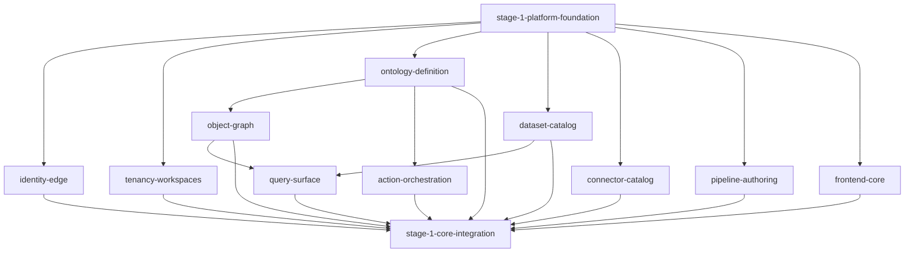

# Stage 1 Change Map — OntoAxis Core 并行拆解

> 状态：approved（负责人复核确认，2026-11-22） 
> 本次更新：按 `ARCHITECTURE.md` v1.0（2026-11-22）同步模块清单、数据所有权、契约基线、目录与部署口径；更新后的 change 边界已按负责人复核确认，作为 Stage 1 新基线。 
> 归属 Stage：[`stage-1-ontoaxis-core-brief.md`](stage-1-ontoaxis-core-brief.md) 
> 用途：把 `ARCHITECTURE.md` v1.0 第 3、5、6、9、16、17 章拆成适合多 Agent 并行执行的 change 包 
> 已确认决策：Go module `github.com/klb3713/ontoaxis`、GitHub Actions、Keycloak 单 realm + Organizations、Trino 真实单节点、Kestra/Temporal 契约适配器、`oa-web` Refine resource-first、actions 只到 Action Type + adapter 骨架；业务模块固定 9 个，`proto/ontoaxis/v1` 的 21 个 proto 文件（1,272 行）作为冻结契约基线。

## 1. 拆解原则

1. **一个 change 一个行为边界**：不把多个模块塞进一个 change；change 目录名描述能力，不带 Stage 前缀（Stage 支撑 change 除外）。
2. **契约先行**：Wave 0 先校验并接入 `proto/ontoaxis/v1`（21 个 proto 文件、1,272 行）、OpenAPI、数据库 schema 与路由表；后续 agent 不靠口头约定。
3. **目录所有权隔离**：每个能力 change 只拥有自己的 `internal/modules/<module>` 与 `openspec/changes/<change>/`；共享文件由固定 owner 修改。
4. **依赖单向**：模块之间只能调用 `service` 接口或 HTTP/Connect API，禁止跨模块直接读表。
5. **每个 change 自带验证**：迁移 SQL、handler、repo、单元测试、至少一个 fixture；完成定义见第 6 节。

## 2. 依赖 DAG

## 3. Change 包清单

| Change | 能力/行为 | 负责目录 | 主要交付 | 验收 |
|---|---|---|---|---|
| `stage-1-platform-foundation` | 工程骨架与运行基座 | `cmd/ontoaxis-core`、`internal/app`、`internal/platform`、`go.mod`、`.github/workflows`、`deploy/compose` | Go module `github.com/klb3713/ontoaxis`、config、pgxpool、goose、chi/Connect、`/healthz`、`/readyz`、`/metrics`、错误模型、模块注册接口（`Name/Dependencies/Migrate/RegisterRoutes/Ready`）、`proto/ontoaxis/v1` 生成链、GitHub Actions CI、Compose 骨架、`SPEC.md` 与从 proto 生成的 OpenAPI | S1-AC-01 |
| `identity-edge` | 身份与边缘入口 | `internal/platform/authn`、`config/edge` | Keycloak 单 realm + Organizations、OIDC/JWKS、JWT claims 契约、租户上下文、`oa-edge` YAML 路由表、网关鉴权与 header 清洗、API metadata 对齐、fail-closed 负向测试 | S1-AC-02 |
| `tenancy-workspaces` | 组织与工作区 | `internal/modules/tenancy` | 组织、工作区、成员关系、项目、项目资源绑定、租户边界、迁移与 CRUD API | S1-AC-03 |
| `ontology-definition` | Ontology 元数据 | `internal/modules/ontology` | Object Type、Property、Link Type、Dataset Binding | S1-AC-04 |
| `dataset-catalog` | 数据集元数据 | `internal/modules/datasets` | Dataset、Branch、Transaction、View、S3 文件元数据、状态机 | S1-AC-06 |
| `connector-catalog` | 连接器与同步 | `internal/modules/connectors`、`internal/modules/ingestion` | Connector 定义、配置、同步任务/运行状态；Meltano/Kafka Connect 适配边界 | S1-AC-08 |
| `pipeline-authoring` | 管道定义 | `internal/modules/pipelines` | Pipeline 定义、版本、运行入口、Kestra 契约适配（Stage 1 不接真实实例） | S1-AC-09 |
| `frontend-core` | 前端核心工作台 | `web/` | Refine resource-first + 薄页面：登录、Projects、Ontology Manager、Object Explorer、Datasets、Queries；生成客户端 | S1-AC-10 |
| `object-graph` | 对象与链接 | `internal/modules/objects` | JSONB 对象/链接、分页/过滤、Meilisearch 索引边界 | S1-AC-05 |
| `query-surface` | 查询 API | `internal/modules/query` | 保存查询、执行查询、对象查询、真实单节点 Trino 适配 | S1-AC-07 |
| `action-orchestration` | 动作执行 | `internal/modules/actions` | Action Type、校验/预演、Temporal adapter 骨架（不实现真实动作执行） | S1-AC-09 |
| `stage-1-core-integration` | 集成与切换 | `cmd`、`internal/app`、`internal/platform/httpserver`、`deploy/` | 合并路由、wire types、全栈 E2E、镜像发布、切换与清理 | S1-AC-11、S1-AC-12 |

## 4. 并行波次与合并门

### Wave 0 — 基座（串行）

- 唯一执行者：`stage-1-platform-foundation` agent。
- 门 G0：
  - `go build ./...` 通过；
  - `/healthz`、`/readyz`、`/metrics` 可访问；
  - `proto/ontoaxis/v1`（21 个文件、1,272 行）、OpenAPI、schema、路由表已冻结，`buf lint`/`buf breaking`/`make generate-check` 通过；
  - CI 骨架可跑；
  - 合入 `main` 后其他 agent 才可创建自己的 worktree。

### Wave 1 — 独立模块（并行）

并行 change：`identity-edge`、`tenancy-workspaces`、`ontology-definition`、`dataset-catalog`、`connector-catalog`、`pipeline-authoring`、`frontend-core`。

- 每个 agent 从 Wave 0 的 `main` 创建独立 worktree：
  - `feat/identity-edge`
  - `feat/tenancy-workspaces`
  - `feat/ontology-definition`
  - `feat/dataset-catalog`
  - `feat/connector-catalog`
  - `feat/pipeline-authoring`
  - `feat/frontend-core`
- 门 G1（每个 change 独立）：
  - `go test ./internal/modules/<module>/...` 或前端 `check/build/test` 通过；
  - 迁移可在本地 Postgres 跑通；
  - OpenAPI/TypeScript 类型与冻结契约一致；
  - 本 change 的 E2E fixture 或 handler 测试至少一个。

### Wave 2 — 依赖模块（并行）

并行 change：`object-graph`（依赖 ontology）、`query-surface`（依赖 datasets + objects）、`action-orchestration`（依赖 ontology）。

- worktree：`feat/object-graph`、`feat/query-surface`、`feat/action-orchestration`
- 门 G2：
  - `object-graph` 的对象/链接 CRUD 与分页测试通过；
  - `query-surface` 的保存查询/执行查询契约测试通过；
  - `action-orchestration` 的 Action Type + 校验/预演 + adapter 接口测试通过（不执行真实动作）。

### Wave 3 — 集成（串行）

- 唯一执行者：`stage-1-core-integration` agent。
- 门 G3：
  - 合并所有 Wave 1/2 changes；
  - `go build ./...`、`go test ./...`、前端 check/build/test、Playwright E2E 全部通过；
  - Compose 一键起栈；
  - 发布镜像与切换，删除过渡脚手架；
  - Stage 报告和 traceability 完成。

## 5. 共享文件所有权

| 文件/目录 | Owner | 其他 agent 规则 |
|---|---|---|
| `go.mod`、`go.sum` | `stage-1-platform-foundation` | 不直接修改；新增依赖提交 PR 给 foundation owner |
| `cmd/ontoaxis-core/main.go` | `stage-1-platform-foundation`（Wave 0）→ `stage-1-core-integration`（Wave 3） | 模块 agent 不修改；只通过 `platform.Module` 注册（含 `Dependencies()`） |
| `internal/app/*` | `stage-1-platform-foundation`（Wave 0）→ `stage-1-core-integration`（Wave 3） | 模块 agent 不修改；只按固定注册顺序接入 |
| `internal/platform/httpserver/router.go` | `stage-1-platform-foundation`（初始）→ `stage-1-core-integration`（合并） | 模块 agent 只添加自己的 route 注册函数，不直接改总路由 |
| `internal/platform/db/*` 与平台 `jobs` schema | `stage-1-platform-foundation` | 模块迁移必须放 `internal/modules/<module>/migrations`；平台 schema 变更需 foundation 审批 |
| `config/edge/*` | `identity-edge` | 其他 agent 不改 |
| `web/src/router.tsx`、`web/src/app/*`、入口 | `frontend-core` | 其他 agent 不改 |
| `deploy/compose`、`deploy/helm` | `stage-1-platform-foundation`（骨架）→ `stage-1-core-integration`（最终） | 其他 agent 只提交服务片段，不直接改 |
| `openspec/changes/<change>/` | 对应 change agent | 每个 agent 独立目录；禁止改别人 change |

## 6. 完成定义（每个 change）

- `proposal.md`、delta specs、`design.md`（如适用）、`tasks.md`、`traceability.md` 已完成；
- 代码符合 `ARCHITECTURE.md` 的模块边界、数据所有权与命名；
- 迁移 SQL 可重复执行、可回滚或有回填说明；
- 单元测试覆盖成功、无效输入、关键拒绝路径；
- 至少一个 E2E/fixture 或契约测试证明该 change 的对外行为；
- 不修改其他模块目录、不引入未批准依赖、不提交秘密；
- 由集成 agent 验证后才标记 task 完成。

## 7. Agent 提示包模板

每个 change 的启动 prompt 应包含：

1. 必读：`ARCHITECTURE.md` 第 3、5、6、9、16、17 章对应部分、`docs/stages/stage-1-ontoaxis-core-brief.md`、本 change 的 OpenSpec artifacts；
2. 写作范围：仅允许修改 `internal/modules/<module>/`（或 `web/` 等指定目录）；
3. 禁止：修改共享文件、直接读其他模块表、绕过 proto/OpenAPI、写真实数据；
4. 交付：代码 + 迁移 + 测试 + fixture + 变更说明；
5. 验证命令：`go test ./internal/modules/<module>/...` + 对应 API/E2E；
6. 完成后：发回 `git diff --stat`、测试输出、未决风险，不得自行 archive。

## 8. 关键风险

| 风险 | 缓解 |
|---|---|
| 多 agent 同时改 `router.go` / `main.go` / `internal/app` | 共享文件单一 owner；模块只注册子路由 |
| proto/OpenAPI 契约被单个 agent 改动 | 契约冻结；变更必须经 foundation/集成 owner |
| 模块 schema 冲突 | 每模块独立 schema；平台 `jobs` schema 由 foundation 审批 |
| 前端先于后端进度 | 前端先生成 mock/generated client，后端按契约实现 |
| 一次性切换导致不可回滚 | 保留 git tag/镜像；只运行新核心，不保留过渡服务 |
| Agent 伪造测试通过 | 每个任务必须提交可复核日志；集成 agent 重跑全量测试 |
