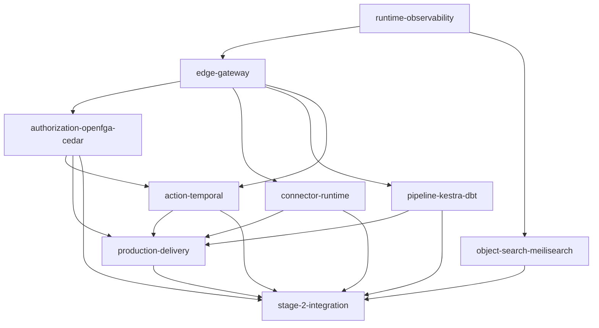

# Stage 2 Change Map — OntoAxis 真实运行时并行拆解

> 状态：approved（随 Stage 2 brief 于 2026-11-22 获批） 
> 归属 Stage：[`stage-2-ontoaxis-runtime-brief.md`](stage-2-ontoaxis-runtime-brief.md) 
> 用途：把 Stage 2 的 9 个 change 拆成可独立交付、可并行执行的包 
> 目标设计：[`ARCHITECTURE.md`](../../ARCHITECTURE.md) v1.3

## 1. 拆解原则

1. **一个 change 一个行为边界**：不同时改 Edge、授权、Temporal 和 Kestra。
2. **运行时独立**：Temporal、Kestra、Kafka Connect、Meilisearch 各自一个 change，避免"多系统联调"混在一个 change；Meltano 不属于 Stage 2。
3. **目录所有权隔离**：每个能力 change 只写自己的模块、平台包与 OpenSpec 目录。
4. **共享文件单一所有权**：`cmd/`、`internal/app/`、`deploy/`、`config/edge/`、`go.mod` 由固定 owner 合并。
5. **真实实例优先**：Stage 2 的完成标准不是"adapter 可替换"，而是真实实例跑通；adapter 仍保留用于本地无外部依赖测试。

## 2. 依赖 DAG

## 3. Change 包清单

| Change | 能力/行为 | 负责目录 | 主要交付 | 验收 |
|---|---|---|---|---|
| `runtime-observability` | 可观测性基础 | `internal/platform/observability`、`deploy/observability/` | OTel SDK 初始化、trace/span 命名、Prometheus 指标规范、SLO/SLI 文档、Grafana/Perses 面板、测试 harness | S2-AC-09 |
| `edge-gateway` | 独立边缘入口 | `config/edge/`、`deploy/edge/` | Envoy Gateway K8s 配置、Traefik Compose 配置、JWT/租户透传、限流、路由负向测试 | S2-AC-02 |
| `authorization-openfga-cedar` | 关系与属性授权 | `internal/platform/authz/`、`internal/modules/*/api/` 授权接缝 | OpenFGA model、Cedar policy、授权中间件、审计事件、跨租户/越权负向测试 | S2-AC-03 |
| `connector-runtime` | 真实连接器同步 | `internal/modules/connectors/`、`internal/modules/ingestion/` | Kafka Connect/Debezium 配置与任务提交、同步状态回写、真实同步 E2E；Meltano 不在范围内 | S2-AC-06 |
| `pipeline-kestra-dbt` | 真实 Pipeline 执行 | `internal/modules/pipelines/` | Kestra Flow 生成/发布/触发、dbt 项目与 SQL 转换、运行状态回写、失败重试 E2E | S2-AC-05 |
| `action-temporal` | 真实 Action 执行 | `internal/modules/actions/` | Temporal workflow/activity、重试/补偿/审批、最小审批 UI（如需）与 E2E | S2-AC-04 |
| `object-search-meilisearch` | 对象搜索索引 | `internal/modules/objects/`、`internal/platform/search/` | outbox 索引消费者、Meilisearch 索引、增量更新/重建、搜索 E2E | S2-AC-07 |
| `production-delivery` | 生产交付 | `deploy/helm/`、`deploy/argocd/`、`deploy/compose/`、`config/` | Helm chart、ArgoCD Application、Secret/PDB/探针、kind/k3d 部署、备份恢复、镜像回滚、生产 IdP 验证 | S2-AC-08、S2-AC-10 |
| `stage-2-integration` | 集成与证据 | `cmd/`、`internal/app/`、`deploy/`、`docs/stages/evidence/` | 模块装配、跨 change 修复、全栈 E2E、证据、Stage 2 报告 | S2-AC-01、S2-AC-11 |

> 状态（2026-11-22）：`runtime-observability` 已归档（`openspec/changes/archive/2026-11-22-runtime-observability/`，主 spec `openspec/specs/observability/`）；`edge-gateway` 已归档（`openspec/changes/archive/2026-11-22-edge-gateway/`，主 spec `openspec/specs/edge-gateway/`），Envoy kind 与 Traefik Compose 双 provider 验证通过，CI 45026353151 全绿；当前 Wave 0 下一 change 为 `authorization-openfga-cedar`，其余 change 仍为计划中。

## 4. 并行波次与合并门

### Wave 0 — 平台入口与授权（串行）

顺序：`runtime-observability` → `edge-gateway` → `authorization-openfga-cedar`。

门 G0：

- trace 在 core 请求中可见；`/metrics` 包含新规范指标；
- edge 路由与 Stage 1 一致，401/403/限流/404 负向测试通过；
- 授权模型、策略与拒绝路径通过负向测试；
- `go build ./...`、`go test ./...`、Stage 1 回归通过；Compose 与 kind/k3d 至少一种方式可启动。

### Wave 1 — 真实执行（3 个并行）

并行 change：`connector-runtime`、`pipeline-kestra-dbt`、`action-temporal`。

门 G1：

- 每个 change 的真实实例在 Compose profile 或 kind 中启动；
- 成功路径、失败重试、拒绝路径均有集成测试；
- 外部实例不可用时，adapter 降级行为明确且不冒充成功；
- 授权 change 的跨租户/越权测试全部拒绝。

### Wave 2 — 搜索与生产交付（2 个并行）

并行 change：`object-search-meilisearch`、`production-delivery`。

门 G2：

- outbox → Meilisearch 对象搜索 E2E 通过，增量更新与全量重建可复现；
- Helm/ArgoCD 在 kind/k3d 完成部署，探针/PDB/Secret 生效；
- 备份恢复与镜像回滚演练通过；
- 生产 IdP 使用非本地 OIDC issuer 完成登录与 token 校验；
- 所有 Wave 1 服务的 compose/helm 配置可启动。

### Wave 3 — 集成

串行 change：`stage-2-integration`。

门 G3（Stage 2 退出候选）：

- 9 个模块装配不变，所有 Stage 2 AC 有证据；
- Compose 与 kind/k3d 均完成全栈 E2E；
- CI、契约、许可证、Playwright、负载基线全部通过；
- Stage 2 报告与证据归档，等待负责人确认退出。

## 5. 共享文件所有权

| 文件/目录 | Owner | 其他 change 的规则 |
|---|---|---|
| `cmd/ontoaxis-core/` | `stage-2-integration` | 只提 patch，不直接改 main |
| `internal/app/` | `stage-2-integration` | 模块注册由集成 change 合并 |
| `config/edge/` | `edge-gateway` | authz 不直接改路由，只提供中间件 |
| `deploy/compose/` | `production-delivery` | 各 change 提供 profile 片段，由 delivery 合并 |
| `deploy/helm/`、`deploy/argocd/` | `production-delivery` | 其他 change 不直接改 |
| `go.mod`、`go.sum` | 需要新依赖的 change 提交补丁 | 集成 change 统一 tidy |
| `web/` | `action-temporal`（如审批 UI） | 其他 change 默认不改前端 |
| `docs/stages/evidence/` | `stage-2-integration` | 各 change 提供证据源文件 |

## 6. 每个 Change 的完成定义

1. proposal / delta specs / design（如需要）/ tasks / traceability 完整；
2. 至少一个真实实例的集成测试，不是只有 fake/adapter；
3. 成功路径、非法输入、关键拒绝路径都有测试；
4. `openspec validate <change> --strict` 通过；
5. 证据可复核，未完成项明确标记；
6. 不修改其他 change 的目录，不提交共享文件。

## 7. Agent 提示包

每个 change 的 agent 必须收到：

- Stage 2 brief 与本 change map 对应行；
- 本 change 的 `openspec/changes/<change>/` artifacts；
- `ARCHITECTURE.md` 相关章节；
- 负责目录与共享文件禁改清单；
- 真实实例的连接方式、启动命令与测试数据边界；
- 完成定义与证据要求；
- 明确"禁止自动 commit、禁止归档、禁止宣布 Stage 完成"。

## 8. 风险与缓解

| 风险 | 影响 | 缓解 |
|---|---|---|
| Stage 2 范围过大 | 无法在合理周期退出 | 9 个 change 固定；范围外需求进 Stage 3 |
| Temporal/Kestra/Kafka 多系统联调 | 故障难定位 | 每个 change 独立 compose profile，按依赖顺序合入 |
| OpenFGA/Cedar 权限模型错误 | 安全边界失效 | 默认拒绝 + 安全评审 + 负向测试先行 |
| 生产交付依赖真实集群 | 环境不可用阻塞 | Stage 2 只用 kind/k3d 与预发，不接触真实云账号 |
| Meilisearch 索引一致性 | 搜索结果与 DB 不一致 | outbox 重放 + 全量重建 + 对账测试 |
| 生产 IdP 配置差异 | 登录不可用 | 预发环境验证 issuer/JWKS/claims，不提交密钥 |
| 为通过验收关闭鉴权 | 安全边界失效 | 禁止 `AUTH_DISABLED`；测试使用受控 token |

## 9. 关联文档

- [`stage-2-ontoaxis-runtime-brief.md`](stage-2-ontoaxis-runtime-brief.md)
- [`ARCHITECTURE.md`](../../ARCHITECTURE.md)
- [`docs/workflow/RUNBOOK.md`](../workflow/RUNBOOK.md)
