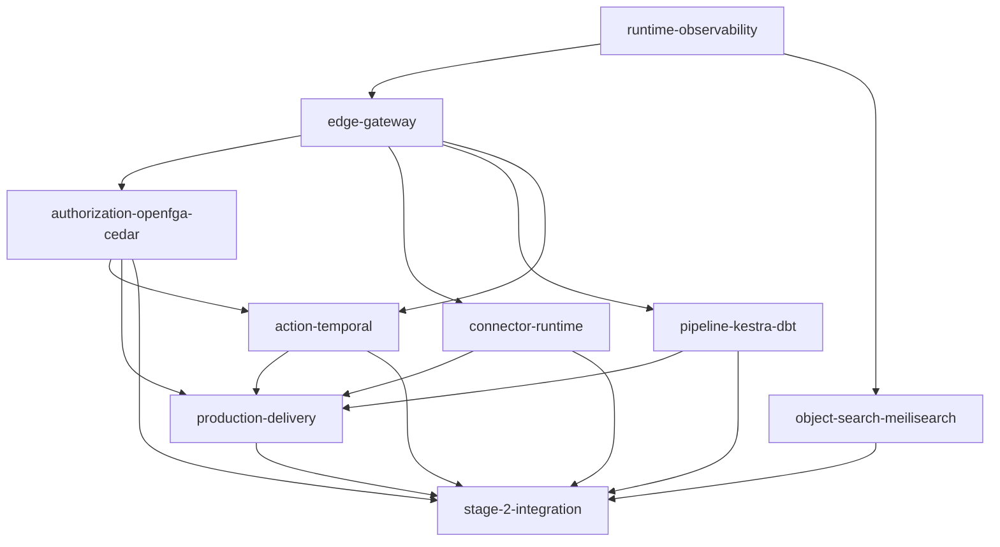

# Stage 2 Change Map — OntoAxis 真实运行时并行拆解

> 状态：approved（随 Stage 2 brief 于 2026-11-22 获批）；剩余 7 个 change 的规划评审已于 2026-11-22 通过，实施未启动（见 §10） 
> 归属 Stage：[`stage-2-ontoaxis-runtime-brief.md`](stage-2-ontoaxis-runtime-brief.md) 
> 用途：把 Stage 2 的 9 个 change 拆成可独立交付、可并行执行的包 
> 目标设计：[`ARCHITECTURE.md`](../../ARCHITECTURE.md) v1.3

## 1. 拆解原则

1. **一个 change 一个行为边界**：不同时改 Edge、授权、Temporal 和 Kestra。
2. **运行时独立**：Temporal、Kestra、Kafka Connect、Meilisearch 各自一个 change，避免"多系统联调"混在一个 change；Meltano 不属于 Stage 2。
3. **目录所有权隔离**：每个能力 change 只写自己的模块、平台包与 OpenSpec 目录。
4. **共享文件单一所有权**：`cmd/`、`internal/app/`、`deploy/`、`config/edge/`、`go.mod` 由固定 owner 合并。
5. **真实实例优先**：Stage 2 的完成标准不是"adapter 可替换"，而是真实实例跑通；adapter 仍保留用于本地无外部依赖测试。

## 2. 依赖 DAG

## 3. Change 包清单

| Change | 能力/行为 | 负责目录 | 主要交付 | 验收 |
|---|---|---|---|---|
| `runtime-observability` | 可观测性基础 | `internal/platform/observability`、`deploy/observability/` | OTel SDK 初始化、trace/span 命名、Prometheus 指标规范、SLO/SLI 文档、Grafana/Perses 面板、测试 harness | S2-AC-09 |
| `edge-gateway` | 独立边缘入口 | `config/edge/`、`deploy/edge/` | Envoy Gateway K8s 配置、Traefik Compose 配置、JWT/租户透传、限流、路由负向测试 | S2-AC-02 |
| `authorization-openfga-cedar` | 关系与属性授权 | `internal/platform/authz/`、`internal/modules/*/api/` 授权接缝 | OpenFGA model、Cedar policy、授权中间件、审计事件、跨租户/越权负向测试 | S2-AC-03 |
| `connector-runtime` | 真实连接器同步 | `internal/modules/connectors/`、`internal/modules/ingestion/` | Kafka Connect/Debezium 配置与任务提交、同步状态回写、真实同步 E2E；Meltano 不在范围内 | S2-AC-06 |
| `pipeline-kestra-dbt` | 真实 Pipeline 执行 | `internal/modules/pipelines/` | Kestra Flow 生成/发布/触发、dbt 项目与 SQL 转换、运行状态回写、失败重试 E2E | S2-AC-05 |
| `action-temporal` | 真实 Action 执行 | `internal/modules/actions/` | Temporal workflow/activity、重试/补偿/审批、最小审批 UI（如需）与 E2E | S2-AC-04 |
| `object-search-meilisearch` | 对象搜索索引 | `internal/modules/objects/`、`internal/platform/search/` | outbox 索引消费者、Meilisearch 索引、增量更新/重建、搜索 E2E | S2-AC-07 |
| `production-delivery` | 生产交付 | `deploy/helm/`、`deploy/argocd/`、`deploy/compose/`、`config/` | Helm chart、ArgoCD Application、Secret/PDB/探针、kind/k3d 部署、备份恢复、镜像回滚、生产 IdP 验证 | S2-AC-08、S2-AC-10 |
| `stage-2-integration` | 集成与证据 | `cmd/`、`internal/app/`、`deploy/`、`docs/stages/evidence/` | 模块装配、跨 change 修复、全栈 E2E、证据、Stage 2 报告 | S2-AC-01、S2-AC-11 |
| `stage-2-dependency-governance` | 依赖版本治理（Stage 支撑） | `deploy/deps/`、`scripts/deps.*`、`.github/workflows/deps.yml` | policy/lock 单一真源、`make deps-check` 门禁、Renovate 分级合并、月度审计报告 | 支撑 S2-AC-08、S2-AC-11 |

> 状态（2026-11-22）：`runtime-observability` 已归档（主 spec `openspec/specs/observability/`）；`edge-gateway` 已归档（主 spec `openspec/specs/edge-gateway/`），Envoy kind 与 Traefik Compose 双 provider 验证通过，CI 45026353151 全绿。剩余 7 个 change 已一次性创建规划产物，统一评审包见 `docs/stages/stage-2-change-batch-review.md`；均未开始实施、未归档。授权边界已于 2026-11-22 定稿，负责人确认安全评审通过。
>
> 状态（2026-11-23）：新增 Stage 支撑 change `stage-2-dependency-governance`（依赖版本单一真源与门禁），规划产物已创建，实施已获授权；对应 `deploy/deps/` 与 `scripts/deps.*` 的所有权在 §5 登记。
>
> 状态（2026-11-23 归档）：`pipeline-kestra-dbt` 已完成 69/69 并归档为 `2026-11-23-pipeline-kestra-dbt`（Kestra v2.0.12 + dbt 真实 E2E），delta spec 已合入 `openspec/specs/pipelines/spec.md`。当前在途 5 个 change：`connector-runtime`、`object-search-meilisearch`、`production-delivery`、`stage-2-integration`、`stage-2-dependency-governance`。
>
> 状态（2026-11-23 归档）：`stage-2-dependency-governance` 已完成 19/19（含 4 项一致性修正与块外镜像覆盖）并归档为 `2026-11-23-stage-2-dependency-governance`（`openspec/changes/archive/2026-11-23-stage-2-dependency-governance/`），主 spec 写入 `openspec/specs/dependency-governance/spec.md`。Helm 占位 digest 回填等 3 项显式移交，见 §11 台账；当前在途 4 个 change：`connector-runtime`、`object-search-meilisearch`、`production-delivery`、`stage-2-integration`。
>
> 状态（2026-11-23 归属修正）：`jaeger-v2` 的规划产物已创建，但**不属于 Stage 2 范围**——Stage 2 brief §5 未列入，§2.1 可观测交付与 S2-AC-09 也不要求 Jaeger v2，Stage 2 退出条件 6 只要求 `deps-check` 通过、无过期例外。该 change 改登记到 §12「Stage 外/后续候选」，Stage 2 在途仍为 4 个 change：`connector-runtime`、`object-search-meilisearch`、`production-delivery`、`stage-2-integration`。

## 4. 并行波次与合并门

### Wave 0 — 平台入口与授权（串行）

顺序：`runtime-observability` → `edge-gateway` → `authorization-openfga-cedar`。

门 G0：

- trace 在 core 请求中可见；`/metrics` 包含新规范指标；
- edge 路由与 Stage 1 一致，401/403/限流/404 负向测试通过；
- 授权模型、策略与拒绝路径通过负向测试；
- `go build ./...`、`go test ./...`、Stage 1 回归通过；Compose 与 kind/k3d 至少一种方式可启动。

### Wave 1 — 真实执行（3 个并行）

并行 change：`connector-runtime`、`pipeline-kestra-dbt`、`action-temporal`。

门 G1：

- 每个 change 的真实实例在 Compose profile 或 kind 中启动；
- 成功路径、失败重试、拒绝路径均有集成测试；
- 外部实例不可用时，adapter 降级行为明确且不冒充成功；
- 授权 change 的跨租户/越权测试全部拒绝。

### Wave 2 — 搜索与生产交付（2 个并行）

并行 change：`object-search-meilisearch`、`production-delivery`。

门 G2：

- outbox → Meilisearch 对象搜索 E2E 通过，增量更新与全量重建可复现；
- Helm/ArgoCD 在 kind/k3d 完成部署，探针/PDB/Secret 生效；
- 备份恢复与镜像回滚演练通过；
- 生产 IdP 使用非本地 OIDC issuer 完成登录与 token 校验；
- 所有 Wave 1 服务的 compose/helm 配置可启动。

### Wave 3 — 集成

串行 change：`stage-2-integration`。

门 G3（Stage 2 退出候选）：

- 9 个模块装配不变，所有 Stage 2 AC 有证据；
- Compose 与 kind/k3d 均完成全栈 E2E；
- CI、契约、许可证、Playwright、负载基线全部通过；
- Stage 2 报告与证据归档，等待负责人确认退出。

## 5. 共享文件所有权

| 文件/目录 | Owner | 其他 change 的规则 |
|---|---|---|
| `cmd/ontoaxis-core/` | `stage-2-integration` | 只提 patch，不直接改 main |
| `internal/app/` | `stage-2-integration` | 模块注册由集成 change 合并 |
| `config/edge/` | `edge-gateway` | authz 不直接改路由，只提供中间件 |
| `deploy/compose/` | `production-delivery` | 各 change 提供 profile 片段，由 delivery 合并 |
| `deploy/helm/`、`deploy/argocd/` | `production-delivery` | 其他 change 不直接改 |
| `go.mod`、`go.sum` | 需要新依赖的 change 提交补丁 | 集成 change 统一 tidy |
| `web/` | `action-temporal`（如审批 UI） | 其他 change 默认不改前端 |
| `docs/stages/evidence/` | `stage-2-integration` | 各 change 提供证据源文件 |
| `deploy/deps/`、`renovate.json`、`.github/workflows/deps.yml`、`scripts/deps.py`、`scripts/deps.sh` | `stage-2-dependency-governance` | 其他 change 只改自己组件的 tag/digest，然后跑 `make deps-lock` 并提交锁文件 |

## 6. 每个 Change 的完成定义

1. proposal / delta specs / design（如需要）/ tasks / traceability 完整；
2. 至少一个真实实例的集成测试，不是只有 fake/adapter；
3. 成功路径、非法输入、关键拒绝路径都有测试；
4. `openspec validate <change> --strict` 通过；
5. 证据可复核，未完成项明确标记；
6. 不修改其他 change 的目录，不提交共享文件。

## 7. Agent 提示包

每个 change 的 agent 必须收到：

- Stage 2 brief 与本 change map 对应行；
- 本 change 的 `openspec/changes/<change>/` artifacts；
- `ARCHITECTURE.md` 相关章节；
- 负责目录与共享文件禁改清单；
- 真实实例的连接方式、启动命令与测试数据边界；
- 完成定义与证据要求；
- 明确"禁止自动 commit、禁止归档、禁止宣布 Stage 完成"。

## 8. 风险与缓解

| 风险 | 影响 | 缓解 |
|---|---|---|
| Stage 2 范围过大 | 无法在合理周期退出 | 9 个 change 固定；范围外需求进 Stage 3 |
| Temporal/Kestra/Kafka 多系统联调 | 故障难定位 | 每个 change 独立 compose profile，按依赖顺序合入 |
| OpenFGA/Cedar 权限模型错误 | 安全边界失效 | 默认拒绝 + 安全评审 + 负向测试先行 |
| 生产交付依赖真实集群 | 环境不可用阻塞 | Stage 2 只用 kind/k3d 与预发，不接触真实云账号 |
| Meilisearch 索引一致性 | 搜索结果与 DB 不一致 | outbox 重放 + 全量重建 + 对账测试 |
| 生产 IdP 配置差异 | 登录不可用 | 预发环境验证 issuer/JWKS/claims，不提交密钥 |
| 为通过验收关闭鉴权 | 安全边界失效 | 禁止 `AUTH_DISABLED`；测试使用受控 token |

## 9. 关联文档

- [`stage-2-ontoaxis-runtime-brief.md`](stage-2-ontoaxis-runtime-brief.md)
- [`ARCHITECTURE.md`](../../ARCHITECTURE.md)
- [`docs/workflow/RUNBOOK.md`](../workflow/RUNBOOK.md)

## 10. 规划评审结论（2026-11-22）

**状态：本批 7 个 change 的规划产物已通过负责人评审；`authorization-openfga-cedar` 已于 2026-11-23 归档（43/43），`pipeline-kestra-dbt` 已于 2026-11-23 归档（69/69），其余 change 按计划逐个实施。**

评审确认的范围与决策：

1. `authorization-openfga-cedar`、`connector-runtime`、`pipeline-kestra-dbt`、`action-temporal`、`object-search-meilisearch`、`production-delivery`、`stage-2-integration` 按 `docs/stages/stage-2-change-batch-review.md` 的拆分进入实施队列，每个 change 在启动实施前仍需单独确认。
2. **G0/G1 不得在规划阶段标记 `pass`**：G0 在 `authorization-openfga-cedar` 实现并通过跨租户/越权负向测试后登记；G1 在 Wave 1 三个 change 完成后登记。规划评审不是门禁通过。
3. 运行时版本与形态：OpenFGA、Kestra、Temporal、Meilisearch 均固定具体稳定 patch 并记录镜像 digest，不使用 `latest`；Stage 2 使用单实例 + PostgreSQL 的轻量形态，HA/生产级拓扑交由 `production-delivery` 后续演进。
4. `action-temporal` 包含最小 `/approvals` UI（待审批列表、详情、Approve/Reject + 备注），不做流程设计器或批量审批。
5. `kind` 为唯一主证据栈；`k3d` 仅作为开发者可选回路，不进入 CI 或 Stage 验收。
6. `authorization-openfga-cedar` 的边界文档 `docs/architecture/authorization-boundary.md` 已定稿；安全评审通过由负责人于 2026-11-22 确认，实施仍需该 change 单独授权。

**实施进度**：`authorization-openfga-cedar` 已完成 43/43 并归档为 `2026-11-23-authorization-openfga-cedar`；归档证据包含真实 datasets handler + 真实 OpenFGA 集成、29 条负向矩阵、审计一致性、`authz-integration` CI job。其余 change 仍在途，不得因本 change 归档而视为 Stage 2 完成。

`connector-runtime` 已按 Stage 2 实施目标启动：connectors/ingestion 运行时、调度/对账、迁移与 `deploy/connector-runtime/` 资产已实现，单元/race/静态校验通过；真实 Kafka Connect/Trino E2E、`SnapshotVerifier` 装配与 `internal/app` 接线未完成，因此尚未归档。

**实施进度更新（2026-11-23）**：`authorization-openfga-cedar` 已归档；`pipeline-kestra-dbt` 已完成 69/69 并归档（`2026-11-23-pipeline-kestra-dbt`）；其余 5 个 change 仍在途。本地单元/静态证据可用，但真实集群/运行时 E2E（CDC、搜索、kind 交付）尚未闭合，不能据此判定 Stage AC 通过。

| change | 任务 | 当前实现边界 |
| --- | --- | --- |
| `authorization-openfga-cedar` | 43/43（已归档 2026-11-23） | 核心 authz、策略、9 模块接缝、真实 handler + 真实 OpenFGA 集成、29 条负向矩阵、审计一致性、CI job；见 `openspec/changes/archive/2026-11-23-authorization-openfga-cedar/` |
| `connector-runtime` | 20/25 | connectors/ingestion runtime、调度/对账、迁移、Compose 资产；真实 Connect/Trino E2E 与 verifier 未闭合 |
| `pipeline-kestra-dbt` | 69/69（已归档 2026-11-23） | DAG/Flow/dbt/HTTP adapter（Kestra v2.0.12）、service 编排、迁移/单测；真实发布/触发/输出血缘/失败/重试/负向/遥测 E2E 已通过；见 `openspec/changes/archive/2026-11-23-pipeline-kestra-dbt/`，证据交接 `docs/stages/evidence/stage-2-pipeline-kestra-dbt/` |
| `action-temporal` | 55/55（已归档 2026-11-23） | 领域/迁移/repo、Temporal adapter/workflow/worker、审批 REST + UI、proto/幂等/审计/授权接缝、span、真实 Temporal 集成测试与门禁；见 `openspec/changes/archive/2026-11-23-action-temporal/` |
| `object-search-meilisearch` | 32/52 | search 客户端/consumer/rebuild、outbox、search API、app adapter；真实 Meilisearch/Postgres E2E 未闭合 |
| `production-delivery` | 29/66 | Helm/ArgoCD/kind/脚本静态资产与语法校验；helm/kind/ArgoCD/备份/回滚/IdP 全部未执行 |
| `stage-2-integration` | 22/52 | `internal/app`/`cmd` 运行时装配、fail-fast 组合测试、go mod tidy、基础 Compose + OpenFGA 冒烟与重复性完成；Gate G2/kind/全链路 E2E/质量门未闭合 |

## 11. 依赖治理移交台账（2026-11-23）

`stage-2-dependency-governance` 归档时未完成的 3 项从 change tasks 移出，由本台账跟踪（6.2 已于 2026-11-23 完成）。
**这些项不因 change 归档而消失**：Stage 2 退出条件 6「`make deps-check` 通过、无过期例外」
仍要求 6.1 在 2026-12-31 前闭合。

| 项 | 内容 | owner | 期限 | 验收 |
| --- | --- | --- | --- | --- |
| 6.1 | Helm 22 条占位镜像引用回填真实 digest + 补 `image.tag`（21 个组件 + `ontoaxis-jobs` 的 `backup.image`）。jaeger 一行按**当前 v1 版本**钉真实 digest，EOL 风险写入审计备注 | `production-delivery` | 2026-12-31（例外 `helm-placeholder-digests` 到期） | 22 条 `repository`+真实 `digest`+`tag`；`helm template` 输出 `repo@sha256:`；删除例外后 `make deps-check` 通过；审计报告 jaeger 行标注 EOL |
| 6.2 | ~~GitHub Actions `uses:` 改 commit SHA（`ci.yml`/`deps.yml` 共 20 处）~~ **已完成 2026-11-23** | `production-delivery` | ✅ 2026-11-23（原期限 2027-01-31） | 20/20 钉 SHA；`make deps-actions-check` 门禁接入 CI；证据 `docs/stages/evidence/stage-2-dependency-governance/2026-11-23-actions-sha-pin.md` |
| 6.3 | P0 版本升级（Jaeger v2、Keycloak、Temporal、Meilisearch、Traefik、Prometheus/Alertmanager/OTel、PostgreSQL major） | 各组件 owner（见 `deploy/deps/policy.yaml`） | `review_by` 字段 | 每个引擎独立 change，按 `openspec validate --all --strict` 与门禁归档 |

关联约束：

- 6.3 中 Jaeger v2 迁移已单独建规划 change（`openspec/changes/jaeger-v2`，见 §12），**不属于 Stage 2**；Stage 2 内 6.1 先钉 v1 真实 digest 并把 EOL 风险写进审计，v2 迁移随 Stage 3 或独立授权推进；
- 6.1 回填时**不夹带版本升级**：先按当前 compose 版本固定，升级另走 6.3 的 change；
- digest 棘轮 `2027-01-31` 到期后，compose/Dockerfile/Makefile 共 21 条无 digest 引用会从 warning 变 error，需独立 change 收口。

## 12. Stage 外/后续候选 change

以下 change 已存在规划产物，但**不属于 Stage 2 范围**（Stage 2 brief 的 change 清单未列入、
也不为其 AC 或退出条件所必需）。登记在此避免被误计入 Stage 2 在途清单。

| change | 内容 | 当前状态 | 归属与前置 | 与 Stage 2 的关系 |
| --- | --- | --- | --- | --- |
| `jaeger-v2` | Jaeger v1→v2 迁移：镜像、配置、端口契约、smoke 断言 | 规划完成，0/10 任务，未授权实施 | 待 Stage 3 立项或独立授权；目录 `deploy/compose/`、`deploy/helm/ontoaxis-observability/` 归 `production-delivery` | Stage 2 的 6.1 先钉 v1 真实 digest 并记录 EOL；v2 迁移不在 Stage 2 退出判据内 |
